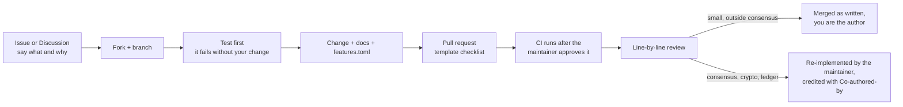

# Contributing to Maya2C

Thank you for looking. Bug reports, docs fixes, tests and ideas all help, and
every one is read in full.

- Questions and ideas: [Discussions](https://github.com/EricWijesinghe/Maya2C/discussions)
- Bugs, features, docs: an issue, using its template
- Vulnerabilities: privately, never in public: [SECURITY.md](SECURITY.md)
- Conduct: [CODE_OF_CONDUCT.md](CODE_OF_CONDUCT.md)

## How a contribution lands



The maintainer is the only person who can merge, and no write access is
handed out. That is a security decision for a chain, not a judgement on you.
In practice:

| Usually merged as written | Usually re-implemented, with credit |
|---|---|
| Docs, guides, typos, broken links | Consensus, state roots, fees, the VM |
| New or better tests | Cryptography and key handling |
| Translations of the site guides | The wire format or `Transaction::verify` |
| Small fixes in apps, SDKs and tooling | Anything that adds a dependency to a core crate |

Credit is a `Co-authored-by` trailer on the commit that lands your idea, and
the [Contributors & badges](https://maya2c.dev/guides/contributors/) page.

## Your first contribution

There is no curated list of starter issues yet, so here is a path that always
has work on it:

1. Run the local devnet (below). Anything that confuses you on the way is a
   docs bug: open a **Docs** issue, or fix it.
2. Read one guide on [maya2c.dev](https://maya2c.dev/guides/) against what the
   code does. A step that is wrong or missing is a good first pull request.
3. Pick a `features.toml` entry marked `working` and read its named tests.
   A behaviour with no test is a good second pull request (tests only, no
   production change).

## Set up

All platforms: install [rustup](https://rustup.rs). The toolchain is pinned in
`rust-toolchain.toml` (a dated nightly) and rustup fetches it on the first
`cargo` command. RocksDB is C++ and its bindings need libclang, which is why
clang appears below.

| OS | Install |
|---|---|
| **Windows** | Visual Studio Build Tools with "Desktop development with C++", and LLVM (`winget install LLVM.LLVM`) for libclang |
| **macOS** | Xcode Command Line Tools (`xcode-select --install`), which provide clang |
| **Linux** (Debian/Ubuntu) | `sudo apt-get install clang mold` (what CI installs). The desktop apps also need `libwebkit2gtk-4.1-dev libayatana-appindicator3-dev librsvg2-dev libxdo-dev libssl-dev libdbus-1-dev` |

Then:

```sh
git clone https://github.com/<you>/Maya2C && cd Maya2C
cargo xtask kit up       # local devnet: validators, gateway, chat relay, faucet, explorer
cargo xtask kit status
cargo xtask kit down
```

Measured build times and every gate: [docs/build.md](docs/build.md).

## The build rule: one cargo scope at a time

This workspace is large (87 members). Two cargo commands running against the
same `target/` at once, for example `cargo test -p vm` in one terminal and
`cargo build --workspace` in another, can corrupt it with
`required to be available in rlib format`. So:

- Run **one cargo command at a time** per checkout, and build only the crate
  you changed: `cargo test -p <crate>`, not `--workspace`.
- `jobs = 4` in `.cargo/config.toml` is deliberate. Wider builds ran the
  maintainer's machine out of memory (`os error 1455`).
- Want two builds in parallel? Use a second `git worktree` with its own
  `target/`. Never share one `CARGO_TARGET_DIR` between worktrees: it silently
  links the other branch's crates.
- Check free disk space before a long build (`cargo xtask disk`).

## Tests first

1. Write the test and watch it **fail** for the reason you expect.
2. Make the smallest change that turns it green.
3. Paste the real command output in the pull request. A result nobody ran is
   not a result here: "zero warnings" or "all tests pass" needs the output
   beside it.

Tests must fail when the feature is broken. If you add or change what a
subsystem does, update its `features.toml` entry in the same pull request
and name the tests that prove it. CI's reality-ledger check fails when an
entry claims `working` or `verified` without a real test.

## Consensus, crypto and ledger changes

Read [docs/invariants.md](docs/invariants.md) first. A change to consensus,
state, the wire format or cryptography also needs:

- a spec update in `spec/` and conformance vectors (`cargo xtask spec-coverage`);
- an ADR in [docs/adr/](docs/adr/) if behaviour changes;
- **two human reviewers**. This is a project rule, not yet enforced by GitHub;
- no floats, no `HashMap` iteration order, no wall-clock time and no
  `unsafe` without a `// SAFETY:` comment and a test.

## Draft pull requests and CI-first work

You do not need a powerful machine. Open a **draft** pull request and let
GitHub's CI be the first compile:

- say "Not compiled locally; CI is the first compile" in the description;
- list anything you could not verify;
- a CI-first pull request never raises a `features.toml` status above `stub`;
- mark it ready for review once CI is green.

CI on a pull request from a fork waits until the maintainer approves the run,
so a fork cannot use this repository's runners or secrets.

## Before you open the pull request

- `cargo fmt -p <crate>` and `cargo clippy -p <crate>`
- `cargo xtask claims-check`: no "first", "only" or "unprecedented" without a
  dated record in `docs/prior-art/`
- a user-visible change also updates its page under `docs/site/`
- no secrets, keys, seed phrases or personal data anywhere in the change

## Rules GitHub enforces on `master`

- No direct pushes: every change arrives through a pull request.
- Required checks: reality ledger, spec conformance, rustfmt, clippy,
  nextest (core), cargo-deny.
- No force-push and no deletion.
- Release tags can only be created by the maintainer and never moved.

## Releases

Only the newest release stays published. Older ones are removed when
superseded, so known-vulnerable binaries are not left up for download. Their
source stays in git history.
