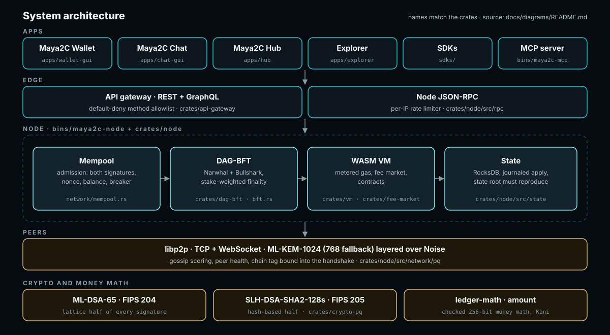
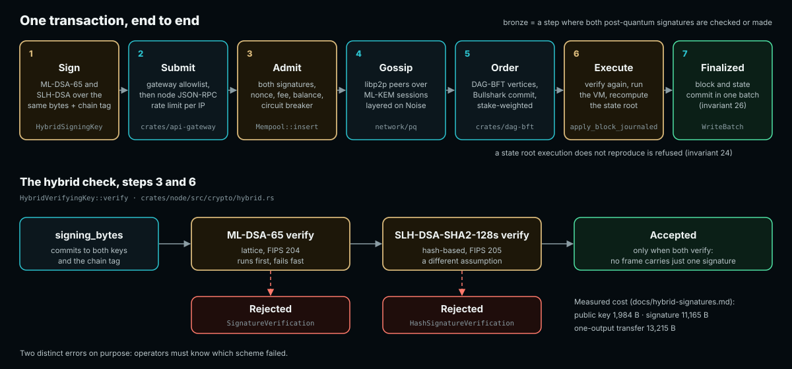
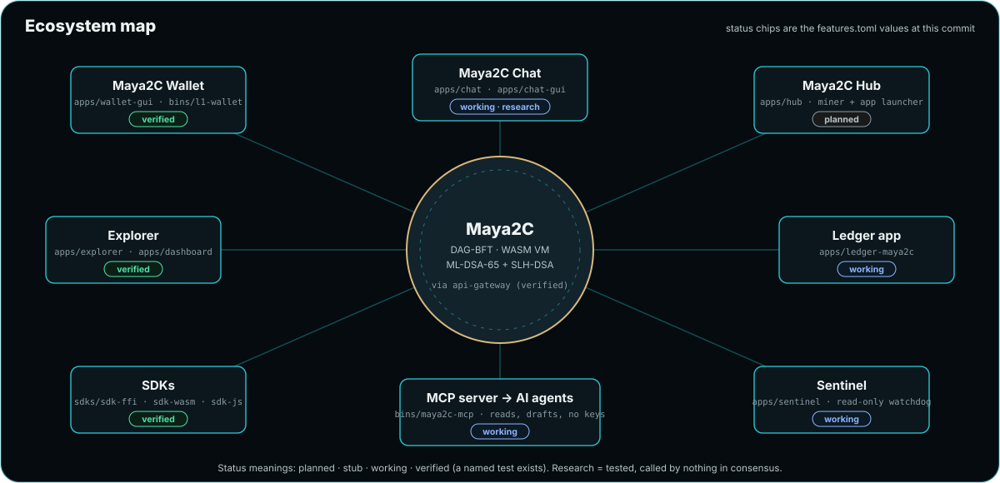
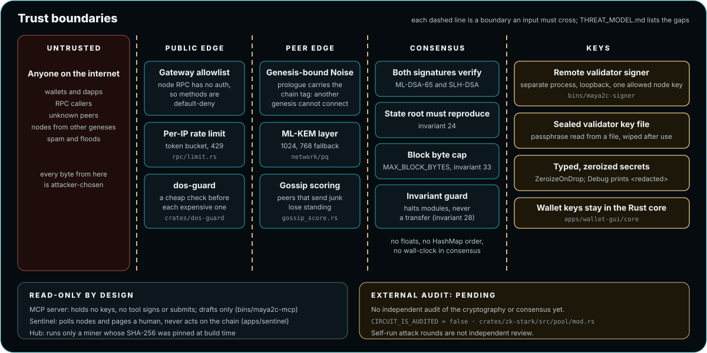
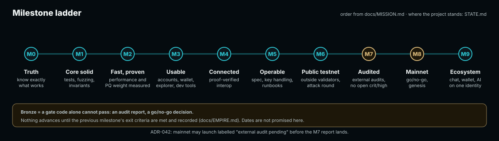

<p align="center">
  <a href="https://maya2c.dev">
    <picture>
      <source media="(prefers-color-scheme: dark)" srcset=".github/assets/banner-dark.svg">
      <source media="(prefers-color-scheme: light)" srcset=".github/assets/banner-light.svg">
      
    </picture>
  </a>
</p>

<p align="center">
  <b>A Layer-1 blockchain in Rust where every transaction carries two post-quantum signatures from different families, and both must verify.</b>
</p>

<p align="center">
  <a href="https://github.com/EricWijesinghe/Maya2C/actions/workflows/ci.yml?query=branch%3Amaster"></a>
  <a href="https://github.com/EricWijesinghe/Maya2C/pulse"></a>
  <a href="https://github.com/EricWijesinghe/Maya2C/commits/master"></a>
  <a href="Cargo.toml"></a>
  <a href="LICENSE"></a>
</p>

<p align="center">
  <a href="https://maya2c.dev"><b>Website</b></a> ·
  <a href="docs/README.md">Docs</a> ·
  <a href="docs/ecosystem/ROADMAP.md">Roadmap</a> ·
  <a href="CHANGELOG.md">Changelog</a> ·
  <a href="https://github.com/EricWijesinghe/Maya2C/discussions">Discussions</a> ·
  <a href="https://github.com/EricWijesinghe/Maya2C/contribute">Good first issues</a> ·
  <a href="SECURITY.md">Security</a>
</p>

> [!IMPORTANT]
> **Status.** Mainnet is **not live**. The public testnet is **paused**: it ran
> 7 days 15 hours with zero halts and was stopped on purpose on 2026-10-28
> ([proof](reports/sessions/2026-10-28-testnet-stopped.md)).
> **Pre-audit:** no external audit yet. Validators are run by one operator at
> launch; an external audit is planned after funding
> ([ADR-042](docs/adr/ADR-042-solo-launch-path.md)). Shielded transfers stay
> off at genesis until their circuit is externally audited
> ([docs/mainnet-v1-plan.md](docs/mainnet-v1-plan.md)). The testnet coin has no value.

## What Maya2C is

| | |
|---|---|
| **Signatures** | Every transaction is signed with **ML-DSA-65** (FIPS 204, lattice) and **SLH-DSA-SHA2-128s** (FIPS 205, hash-based) over the same bytes. A break of one family alone does not forge a transaction. |
| **Consensus** | DAG-BFT: Narwhal + Bullshark, stake-weighted finality ([ADR-027](docs/adr/ADR-027-dag-bft-in-the-node.md)). |
| **Execution** | A metered WASM VM, an EIP-1559 fee market over bytes, and a state root every block must reproduce (invariant 24). |
| **Transport** | libp2p over TCP and WebSocket, with ML-KEM-1024 (ML-KEM-768 as fallback) layered on Noise ([docs/pq-transport.md](docs/pq-transport.md)). |
| **Money math** | 256-bit amounts in `ledger-math`, which keeps C and C++ out of its dependency graph so Kani can check it. |
| **Apps** | Maya2C Wallet, Maya2C Chat, Maya2C Hub, an explorer, SDKs, and an MCP server for AI assistants that reads and drafts but never signs. |

## Architecture

<p align="center"></p>

<p align="center"></p>

Mermaid sources, and what each box was checked against: [docs/diagrams/](docs/diagrams/README.md).
Every top-level directory: [docs/REPO-MAP.md](docs/REPO-MAP.md).

## Why post-quantum matters

A large enough quantum computer breaks the elliptic-curve signatures most
chains use today. Ledgers are permanent: a public key published now can be
attacked whenever such a machine exists. Maya2C uses NIST's post-quantum
standards from genesis, so the default account is post-quantum from its first block, and its
signature-suite registry can add or retire a scheme at an activation height
([ADR-051](docs/adr/ADR-051-security-level-5-defaults.md), invariants 29 to 31).

## How it differs

Other chains are adding post-quantum signatures too; Maya2C is not the first.
The difference is in how. From the dated search in
[docs/prior-art/pq-l1-comparison-2026-11.md](docs/prior-art/pq-l1-comparison-2026-11.md)
(accessed 2026-11-01; read its source weights before quoting it):

| Chain | Post-quantum signatures | Two families, both required |
|---|---|---|
| **Maya2C** | ML-DSA-65 + SLH-DSA-SHA2-128s, the default account suite | Yes |
| QRL 1.x | XMSS, mandatory | No |
| Algorand | Falcon state proofs; opt-in Falcon accounts | No (hybrid with Ed25519 planned) |
| Sui | ML-DSA-65 accounts, opt-in, not yet on mainnet | Optional multisig |
| NEAR | ML-DSA, opt-in key rotation | No |
| Ethereum, Bitcoin | Proposals; nothing activated | n/a |

The cost is size: a hybrid signature is **11,165 bytes** and a one-output
transfer **13,215 bytes** ([docs/hybrid-signatures.md](docs/hybrid-signatures.md)).

## Quickstart

### Use the apps

No release is published yet. When one is, installers for Maya2C Wallet,
Maya2C Chat and the node binaries go on the
[Releases](https://github.com/EricWijesinghe/Maya2C/releases) page with a
`SHA256SUMS` file to check them against. Until then, build from source as
below. Maya2C Hub builds with `cargo xtask hub-bundle`
([apps/hub/README.md](apps/hub/README.md)).

### Run the whole ecosystem locally

Needs the Rust toolchain pinned in `rust-toolchain.toml` (rustup installs it
on first use). The commands take seconds to type; the first build takes longer.

```sh
git clone https://github.com/EricWijesinghe/Maya2C && cd Maya2C
cargo xtask kit up       # 4 DAG-BFT validators, gateway, chat relay, faucet, explorer, funded wallet
cargo xtask kit status   # which endpoints answer
cargo xtask kit down     # stop exactly what `kit up` started
```

Everything listens on 127.0.0.1 and keys are generated fresh each run. The
endpoints are printed and saved to `target/up/up.json`.

| Next | Command |
|---|---|
| Developer CLI: local chain, replay, fork, contract debugger | `cargo run -p maya2c-cli -- dev` |
| Set up and health-check a real node on this machine | `cargo xtask node setup --genesis FILE` then `cargo xtask node doctor` |
| Attack your own throwaway network | `cargo xtask kit attack list` |
| Connect an AI assistant (read and draft only) | `cargo run -p maya2c-mcp -- --rpc 127.0.0.1:8545` |

Build and test rules, with measured times: [docs/build.md](docs/build.md).

## What is real today

`features.toml` is the reality ledger. CI fails when an entry claims
`working` or `verified` without naming a test that exists ([ADR-004](docs/adr/ADR-004-reality-ledger.md)).

<p align="center"></p>

Counts at this commit:

| | Total | verified | working | stub | planned | REAL | RESEARCH | SIM |
|---|---|---|---|---|---|---|---|---|
| Subsystems `[[subsystem]]` | **173** | 61 | 80 | 4 | 28 | 88 | 81 | 4 |
| Register `[[feature]]` | **164** | 50 | 0 | 0 | 114 | 50 | 114 | 0 |

Regenerate it with no build:

```sh
awk '/^\[\[/{s=$1} /^(status|class) *=/{gsub(/[" ]/,"");split($0,a,"=");c[s" "a[2]]++} /^\[\[/{n[$1]++} END{for(k in n)print k,"total",n[k];for(k in c)print k,c[k]}' features.toml | sort
```

`cargo xtask coverage` prints the subsystem counts and checks every named
test. Status meanings and the reasoning behind each subsystem:
[docs/architecture-vision.md](docs/architecture-vision.md).

## Security

<p align="center"></p>

- **No external audit yet.** Fuzzing, Kani checks and self-run attack rounds
  are not independent review ([docs/security-audit.md](docs/security-audit.md)).
- Thirty active invariants, each pinned by a test: [docs/invariants.md](docs/invariants.md).
- Threats and known gaps: [THREAT_MODEL.md](THREAT_MODEL.md).
- Found a vulnerability? Report it privately: [SECURITY.md](SECURITY.md).

## Roadmap

<p align="center"></p>

Apps and services, wave by wave: [docs/ecosystem/ROADMAP.md](docs/ecosystem/ROADMAP.md),
generated from the [ecosystem catalog](docs/ecosystem/CATALOG.md).
Order: [docs/MISSION.md](docs/MISSION.md). Plan: [docs/trajectory.md](docs/trajectory.md).
Done: [PROGRESS.md](PROGRESS.md) and [CHANGELOG.md](CHANGELOG.md), one line per
merged pull request. Where it stands now: [STATE.md](STATE.md).

## Contributing

Suggestions, bug reports, docs fixes and tests are welcome. Issues labelled
[good first issue](https://github.com/EricWijesinghe/Maya2C/labels/good%20first%20issue)
each name the files, the context and the check that proves them done.
[CONTRIBUTING.md](CONTRIBUTING.md) explains setup on each OS, the build rule
that keeps this repository's machine alive, test-first expectations, and what
gets merged as written. Questions go to
[Discussions](https://github.com/EricWijesinghe/Maya2C/discussions). Conduct:
[CODE_OF_CONDUCT.md](CODE_OF_CONDUCT.md).

## Documentation

[docs/README.md](docs/README.md) indexes everything. Start with:

- [architecture-vision.md](docs/architecture-vision.md): every subsystem and its status
- [hybrid-signatures.md](docs/hybrid-signatures.md): the two-signature scheme and its cost
- [mainnet-v1-plan.md](docs/mainnet-v1-plan.md) and [mainnet-readiness.md](docs/mainnet-readiness.md): what launches, and what blocks it
- [launch-checklist.md](docs/launch-checklist.md): what remains before a value-bearing launch

## Branding

Logo assets are in [`logo-assets/`](logo-assets/) and are the source of truth.
`cargo xtask brand-assets --check` and `cargo xtask og-card --check` catch
drift. The README banners and the social preview in `.github/assets/` embed
the official emblem from `logo-assets/website/`, scaled, never redrawn. Brand rules: [BRAND.md](BRAND.md).

## Author

Eric Wijesinghe builds Maya2C. Portfolio: [eric.maya2c.dev](https://eric.maya2c.dev) · GitHub: [@EricWijesinghe](https://github.com/EricWijesinghe)

## License

Apache License 2.0: see [LICENSE](LICENSE) and [NOTICE](NOTICE). You may use,
modify and distribute this code, including commercially, under its terms,
which include an express patent grant.

**The name is not the network.** Anyone may fork the code. The names Maya2C
and MAYA, the emblem, the wordmark and the Forged Light assets are not
licensed to forks ([BRAND.md](BRAND.md)). The canonical network is the one
whose genesis hash and validator set the maintainer publishes
([docs/GENESIS.md](docs/GENESIS.md)). A fork is a separate, empty chain: the
network handshake is bound to the chain tag, so it cannot join or be confused
with the canonical network ([docs/forks.md](docs/forks.md)).
