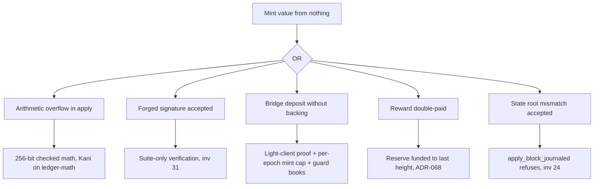
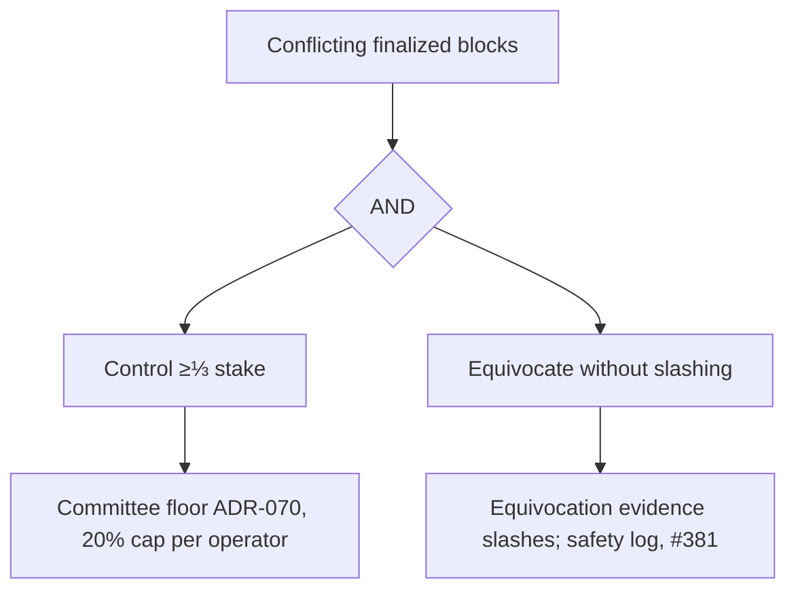
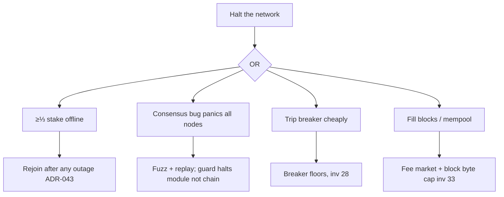
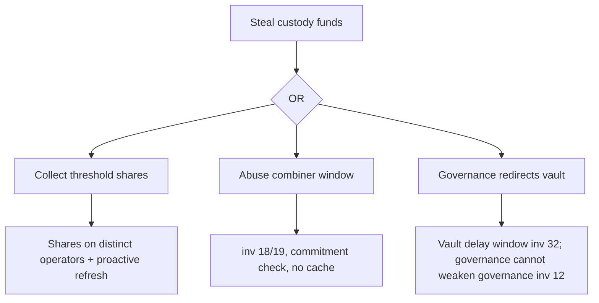
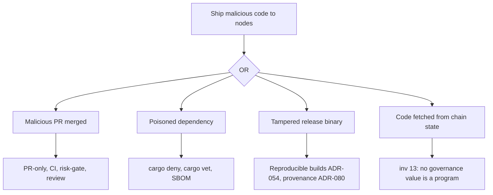

# 01 — Competitive matrix, threat model, attack trees

## 1. Competitive matrix

Competitor entries are general public knowledge as of the author's training, **not
re-verified on 2026-11-08** and quoting no competitor number. Before any public use
(site, deck), each row needs a dated source in `docs/prior-art/` (Standing Order 10).
"QSN" in the brief could not be identified with confidence; it is left blank rather
than guessed.

### 1.1 Per-system: what it does well, where it is weak

| System | Advantage | Weakness / limit | Lesson taken into Maya2C |
|---|---|---|---|
| Bitcoin | Simplest consensus rules; longest uptime record; conservative upgrades | Probabilistic finality; low throughput; ECDSA/Schnorr exposed to quantum; script limits | Keep the consensus core small; upgrades scheduled and visible (ADR-082) |
| Ethereum | Largest developer base; client diversity; economic finality (Gasper) | Finality in minutes; complexity of L1+L2; MEV; ECDSA/BLS quantum exposure | Client diversity as a goal; deterministic finality in seconds |
| Solana | High throughput; parallel execution (Sealevel) | Several full-network outages; heavy validator hardware; restart needed coordination | Degraded modes instead of whole-network stops; rehearsed restart (ADR-082, ADR-043) |
| Cosmos / CometBFT | Instant BFT finality; IBC light-client interop; app-chain sovereignty | Validator set size bounded by all-to-all voting; halts on consensus bugs need coordinated restart | Light-client style verification for interop; committee scaling (04 §5) |
| Avalanche | Sub-second finality via sampling; subnets | Sampling consensus assumptions differ from BFT bounds; subnet security fragmentation | Finality target sub-second; keep one security domain |
| Polkadot | Shared security for parachains; on-chain runtime upgrades (WASM) | Runtime upgrade is a powerful governance lever; complexity | Upgrades never fetch code from state (invariant 13) |
| Sui / Aptos | DAG-based BFT (Narwhal/Bullshark/Mysticeti family; AptosBFT), parallel execution, Move safety | Large validator hardware; Sui validator coordinated freeze of exploited funds (2025) without prior rules | DAG-BFT (ADR-027); recovery rules written in advance (ADR-077) |
| Cardano | Formal methods culture; Ouroboros proofs; eUTXO | Slow feature delivery; probabilistic finality | Formal specs + proofs per subsystem (05 §5) |
| THORChain | Native cross-chain swaps without wrapped assets; TSS vaults; node-operator halts (mimir) | Several 2021 exploits; GG20-family TSS; halts are operator switches; economic security tied to RUNE price | Price-independent caps; graded halts with expiry; no GG20 |
| Maya Protocol | THORChain-derived cross-chain AMM (a separate project; name similarity only) | Inherits THORChain's model | Same lessons; brand kept distinct (memory: one-word "Maya2C") |
| Chainflip | FROST-based threshold vaults; JIT AMM | Vault key ceremony complexity; validator set size bounded by TSS | FROST/ROAST for Schnorr chains (04 §2) |
| Axelar | General message passing; validator-set-secured gateway | Bridge security = its validator set; key-set compromise risk | Exposure capped per epoch and per route |
| LayerZero | Configurable verifiers (DVNs) per app | Security is per-app configuration; defaults matter | Verification is protocol rule, not app choice |
| Hyperlane | Permissionless deployment; pluggable security modules (ISMs) | Same configurability risk | As above |
| Wormhole | Broad chain coverage; guardian set | 2022 signature-verification bug minted unbacked assets | Bridge books asserted by the invariant guard; per-epoch mint cap (ADR-065) |
| IBC | Light-client verification; no third-party trust beyond the two chains | Needs fast-finality chains; client upgrades are delicate | Our light client + attested checkpoints (ADR-038) as the interop base |
| QSN | — not identified — | — | — |
| Celestia | Data availability sampling; modular | DA only; execution elsewhere | DA sampling is a research row, not a v1 item |
| EigenLayer | Restaked security reuse | Correlated slashing risk across services | Never re-use the same stake for unbounded external duties |
| Babylon | Bitcoin-staked security for PoS chains | Depends on Bitcoin script limits and timelocks | Checkpointing to Bitcoin is a research row (05 §7) |
| Kaspa | High-rate PoW BlockDAG (GHOSTDAG / DAGKnight) | PoW finality is probabilistic | Our PoW is a rewards lane only; ordering is BFT (ADR-044) |
| Xelis | BlockDAG with homomorphic confidential balances | Young; small validator/miner set | Privacy is a separate, off-by-default lane |
| Monero | Default privacy (RingCT, stealth addresses) | Large tx size; supply audit relies on cryptography | Shielded pool off at v1; supply conservation checked by the guard |
| Zcash | zk-SNARK privacy (Halo 2, no trusted setup in Orchard) | Optional privacy is little used | STARK joinsplit (no trusted setup) |

### 1.2 Dimension matrix: where Maya2C stands by evidence

Status: **AHEAD-BY-DESIGN** (property present, evidence cited; superiority not
claimed publicly until a prior-art file exists), **PAR**, **BEHIND**, **NOT BUILT**.

| Dimension | Maya2C evidence | Status today | TDD action |
|---|---|---|---|
| Quantum-safe tx signatures | ML-DSA-65 + SLH-DSA hybrid, invariants 29–31 | AHEAD-BY-DESIGN | prior-art file before any claim |
| Quantum-safe validator votes | ML-DSA-87 (`store.rs:66` area) | AHEAD-BY-DESIGN | — |
| Crypto agility without disruption | suite registry + scheduled sunsets (ADR-082, inv 34) | AHEAD-BY-DESIGN | rehearse a sunset on testnet |
| Deterministic finality | DAG-BFT (ADR-027) | PAR with BFT chains | measure latency (ADR-059) |
| Finality latency | MISSING (not measured) | unknown | measure |
| Throughput | MEASURED 502.2/s (23a158f4); 31.3/s (6029a4ba) | BEHIND | P0 re-run, parallel verify (04 §6) |
| Validator count | `MAX_COMMITTEE = 100` | BEHIND large PoS sets | lazy certificates (04 §5) |
| Exploit containment | guard + breakers (inv 28) | AHEAD-BY-DESIGN | L0–L7 (03) |
| Recovery rules written in advance | ADR-077 accepted | AHEAD-BY-DESIGN | build post-mainnet |
| Money arithmetic range | 256-bit everywhere (ADR-066) | AHEAD-BY-DESIGN | — |
| Cross-chain settlement | none (ADR-065 at `u64::MAX`) | NOT BUILT | 04 §2–3 |
| Privacy | STARK joinsplit verified, off at v1 | PAR (off) | post-mainnet |
| Formal verification | Kani (10 files), Lean, Z3, Aeneas dirs (`formal/`) | PAR | coverage targets (05 §5) |
| Reproducible builds / provenance | ADR-054, ADR-080 | PAR | — |
| Decentralization at launch | single machine, disclosed (ADR-042) | BEHIND | operators after launch |
| External audit | none (owner: after mainnet) | BEHIND | after mainnet |

"Beyond everyone on every dimension" requires every BEHIND and NOT BUILT row to
move. Four of them (throughput, validator count, decentralization, external audit)
cannot be moved by design alone; they need measurement, operators and reviewers.

## 2. Threat model

### 2.1 Assets

A1 balances and supply · A2 finality (no conflicting finalized blocks) · A3 liveness ·
A4 validator keys · A5 custody keys (future vaults) · A6 governance/council keys ·
A7 build and release pipeline · A8 the public repo · A9 node operators' machines ·
A10 users' wallets and seeds · A11 cross-chain books (future).

### 2.2 Adversaries and assumed power

| Adversary | Power assumed | Bound the design relies on |
|---|---|---|
| Nation-state | Network-level delay/partition, BGP hijack, a quantum computer later, zero-days, coercion of individuals | BFT safety holds under any delay; liveness after GST; PQ signatures; no single person can sign a state change alone |
| Validator cartel | Up to f of 3f+1 stake Byzantine; colluding ≥⅓ can stop liveness, ≥⅔ can break safety | Safety < ⅓ Byzantine; slashing for equivocation; halt levels needing ⅔ stake for L6–L7 |
| Compromised signer | One validator or custody share exfiltrated | Sealed keys (ADR-049); custody threshold; per-epoch caps bound loss |
| Insider developer | Can author code and PRs | PR-only master, required CI, two-reviewer note, risk-gate, reproducible builds, provenance |
| Supply chain | Malicious crate version, compromised toolchain | `cargo deny` (blocking), `cargo vet` (report-only), pinned toolchain, SBOM, reproducible builds |
| Economic manipulator | Large capital, can move markets and oracle sources | No price on the security path; oracle optional, height-fresh (inv 9, 11); caps in counted units |
| AI-driven exploit search | Fast fuzzing and symbolic search of the public repo | Same tools run first: continuous fuzz, Kani, exploit replays; invariant guard catches what tests miss |
| Cross-chain adversary | Reorgs on a foreign chain, forged proofs, fake deposits | `min_confirmations` per chain from reversal table; light-client proofs; mint cap per epoch |
| Compromised hardware | Backdoored CPU/firmware on some nodes | Diversity of operators; deterministic replay detects divergence; no TEE trusted on consensus |

### 2.3 Out of scope (stated, not hidden)

More than ⅓ Byzantine stake breaking liveness; more than ⅔ breaking safety (no BFT
protocol survives this; detection and social recovery via L7 only). A break of
ML-DSA *and* SLH-DSA at once. Coercion of every key holder at once.

## 3. Attack trees (goal → AND/OR subgoals → mitigation)

## 4. Red-team classes (detail private)

Personas run: nation-state, validator cartel, compromised signer, insider,
supply-chain, economic manipulator, AI exploit search, cross-chain adversary.
Findings are classified only here; reproduction detail is in the private file.

| Class | Count | Highest severity | Where fixed |
|---|---|---|---|
| Throughput collapse under load (finalization gap) | 1 | HIGH (liveness) | P0 step 0 |
| Certificate bandwidth vs committee size | 1 | MEDIUM (scaling) | 04 §5 |
| Single-machine launch correlated failure | 1 | HIGH (accepted, disclosed) | operators post-launch |
| Halt levers not yet built (L0, L2–L7) | 1 | MEDIUM | 03 |
| Supply chain: vet report-only | 1 | MEDIUM | 05 §4 |
| Key-person risk | 1 | HIGH (RISKS.md R1) | operations 05 §3 |

No CRITICAL finding remains open *in this design*. The HIGH rows are either
measurement (step 0) or accepted, disclosed launch conditions.
