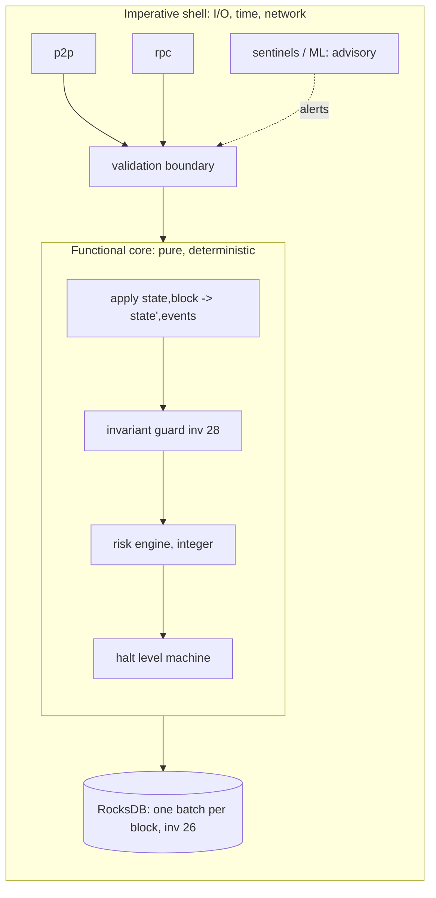
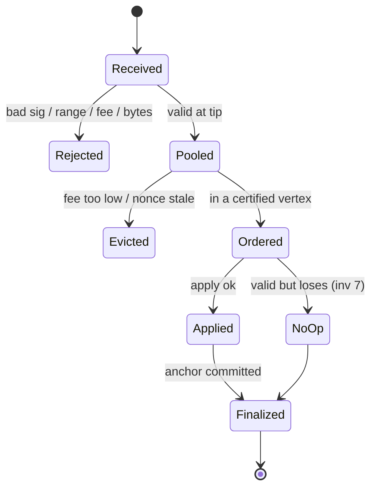

# 02 — Architecture, simplification, state-machine security

## 1. Zero-trust architecture

**Rule:** a component's output is an *input* to the next component, and every
input is validated at the boundary that receives it. Nothing is trusted by role.

| Untrusted party | What it can send | Validation at the boundary |
|---|---|---|
| Users / wallets | transactions | suite-tagged signature (inv 31), nonce, fee, byte cap, 256-bit range |
| Validators | vertices, votes, certificates, blocks | ML-DSA-87 signature bound to chain id (ADR-036), stake weight, equivocation check, state-root re-execution (inv 24) |
| Operators | node config | config cannot change consensus: consensus values are read from state (inv 17) |
| Governance | proposals | cannot weaken governance (inv 12); no program values (inv 13); compiled leads on schedule (inv 34) |
| Council | pause / sunset | bounded, chain-bound approvals (ADR-050), expiring |
| Relayers / bridges | foreign-chain proofs | light-client verification + `min_confirmations` + per-epoch mint cap + guard books |
| Oracles | prices | optional (inv 11), height-fresh (inv 9), never on the security path |
| APIs / RPC | queries | read-only; rate-limited; no RPC writes state except a tx |
| Monitoring / AI | alerts | advisory only; cannot change state (ADR-077 D1) |
| External chains | headers | treated as possibly reorging; reversal table (`docs/crosschain.md`) |

**Accountability:** every state change is the output of `apply(state, block)`; the
block is signed and finalized; the journal records each prior value (inv 8). So
every modification has a signer, a height and an undo record.

## 2. Layering (hexagonal, functional core / imperative shell)

Mapping of the brief's required patterns to this tree:

| Pattern | Where it is (or will be) |
|---|---|
| Functional core / imperative shell | `StateDB::stage_block` builds an overlay from committed state + block only; the shell persists it |
| Deterministic execution | inv 24 (refuse non-reproduced root), no floats (inv 20 rule), no `HashMap` order, no wall clock (Standing Order 4) |
| Event sourcing / immutable logs | the finalized block sequence *is* the event log; the undo journal records prior values (inv 8) |
| State snapshots | snapshot chunks capped by bytes (#380); trusted-block bootstrap (ADR-060) |
| CQRS | writes only through transactions in blocks; reads through RPC/indexer (explorer) |
| Actor model | DAG-BFT driver, mempool, p2p as separate tasks with message channels |
| Capability security | a module may write only its own state prefix; enforced by the prefix map (inv 25) and to be enforced by the risk-gate's write-set check (§3) |
| Domain-driven design | crates per domain: `ledger-math`, `dex`, `governance`, `fee-market`, `custody-mpc`, `vrf` |
| Dependency firewalls | `ledger-math`, `dex` dependency-free (inv 1, 6); forbidden matrix (§3) |
| Formal specifications | `spec/01..09`, `formal/{kani,lean,z3,aeneas}` |
| Module isolation | per-module breakers (inv 28); cells (03 §2) |

## 3. Complexity as a monitored resource: `cargo xtask risk-gate`

A CI job that **fails a PR** that raises systemic risk without a written reason.
Runs on CI only; touches no consensus code. Built in Rust (xtask), per the
prefer-Rust rule.

### 3.1 Per-module metrics (all computed, none guessed)

| Metric | Source |
|---|---|
| `complexity` | max and p95 cyclomatic complexity per function (syn AST walk), max nesting, file lines |
| `auditability` | doc coverage %, spec section exists, invariant ↔ test links, features.toml status |
| `risk` | consensus-critical? (crate list in `features.toml` tier `core`), `unsafe` count, dependency count, fan-in |
| `blast_radius` | number of workspace crates that depend on it transitively × (1 if writes state, else 0.25) — integers, scaled ×100 |

`module_risk = blast_radius × (complexity_penalty + unsafe×50 + deps×5) / max(auditability, 1)`,
all integer arithmetic. Baseline stored in `xtask/risk-baseline.json`, ratcheted like
`lint_debt.sh`.

### 3.2 Forbidden dependency matrix (enforced)

| Crate (consensus core) | Must not depend on |
|---|---|
| `ledger-math`, `dex`, `governance`, `fee-market`, `threat-intel` | any C/C++ crate; any crate outside the allow list (inv 1, 6, 12) |
| `crates/node` state + chain | network crates, `tokio` runtime types in the apply path, ML/ONNX crates (retired inv 20 rule), float math |
| any consensus crate | `std::time::SystemTime`, `rand::thread_rng`, `HashMap` iteration in outputs |
| `crypto-pq` | any second instantiation of `slh-dsa` (inv 2) |

### 3.3 Gate rules

1. Any metric of a `core` crate worse than baseline → **fail** unless the PR body
   has `risk-accepted: <crate> <reason>`, and the reason is copied into the commit.
2. A new edge in the forbidden matrix → **fail**, no override.
3. A new `unsafe` outside the exempt list (Execution Directive 4) → **fail**.
4. A function over cyclomatic 15 or 50 lines in a `core` crate → fail for new code
   (existing ones are the baseline, ratcheted down).
5. `cargo xtask scorecard` writes the six-dimension score per subsystem (00) to
   `reports/scorecard/<date>.md`.

## 4. Module specifications (summary; full specs are `spec/`)

| Module | Owns state prefix | Inputs | Outputs | Must never |
|---|---|---|---|---|
| Ledger (transfers, accounts) | accounts | signed transfers | balance changes | stop below transfer threshold (inv 28) |
| Vault accounts | vault | vault ops | delayed withdrawals | move more than `limit` per `delay_blocks` (inv 32) |
| Staking / committee | staking | bond/unbond/slash | committee per epoch | admit an operator over the stake cap |
| DEX | dex | orders | fills | `Err` on a losing trade (inv 7); skip undo journal (inv 8) |
| Oracle | oracle | signed prices | fresh price | be required (inv 11); use timestamps (inv 9) |
| Governance / council | `g:` | proposals, approvals | parameter changes | weaken itself (inv 12); store programs (inv 13) |
| Upgrade schedule | `up:` | governance/council writes | feature sets, sunsets | activate sooner than compiled lead (inv 34) |
| Guard | `g:guard:` | block + committed state | breaker records | read clock/config (inv 28) |
| Risk engine (new) | `g:risk:` | committed state only | integer risk score per cell | read price unless oracle fresh |
| Halt levels (new) | `g:halt:` | rules + stake-signed actions | level per cell, expiry | freeze core ledger; revert finality |
| Bridge cells (future) | `x:` | light-client proofs | mints/burns | exceed epoch mint cap; unbacked supply |

`g:risk:` and `g:halt:` sit under the governance prefix, as `g:guard:` does, so they
are already under the state root (inv 25) and **need no re-genesis** — this is the
genesis-permanent check for step 2 of the build order.

## 5. State-machine security

### 5.1 Invalid states unreachable: how

Types make the illegal state unrepresentable; the guard catches what types cannot.

| Threat | Mechanism | Status |
|---|---|---|
| Phantom balances | balances only change through `apply`; total supply recomputed and checked against emission per block | guard conservation check (inv 28) — REAL |
| Accounting divergence | state root covers every record (inv 25); a node that diverges refuses the block (inv 24) | REAL |
| Unfunded liabilities | rewards paid only from a reserve funded to the last height (ADR-068) | REAL |
| Subsidy inflation | lifetime emission < 2^192, genesis refuses otherwise (ADR-068) | REAL |
| State corruption | one-batch commit (inv 26); crash test | REAL |
| Double accounting | each prefix has one owning module (§4); risk-gate write-set check | to build |
| Cross-chain drift | bridge books in the guard: `minted_x ≤ locked_x_proven` per route | to build with ADR-065 |
| Replay | chain-bound signatures (ADR-036), nonces | REAL |
| Race conditions | single-threaded apply over a deterministic order; parallel exec only with identical result (RESEARCH) | REAL |
| Message ordering | DAG-BFT total order; mempool order irrelevant to validity | REAL |
| Consensus ambiguity | one canonical encoding (`spec/01-encoding.md`), conformance vectors | REAL |

### 5.2 Transaction lifecycle state machine

### 5.3 Formal security invariants proposed by this TDD

Proposed, not numbered: a number is given only once a test pins it
(CLAUDE.md). Each names the test that would pin it.

| Proposed | Statement | Pinning test |
|---|---|---|
| P-1 | Sum of all balances + reserve + burned = genesis supply + paid emission, every block | property test over random blocks; already partly in guard |
| P-2 | A halt level above L3 exists only with a valid stake-signature set over that exact (cell, level, expiry, chain id) | unit + replay with a forged set |
| P-3 | Every halt level record has an expiry height; no record without one is writable | type: `HaltRecord { expires: Height }` non-optional + test |
| P-4 | No transaction can lower a finalized height's state | replay test: recovery tx never rewrites history |
| P-5 | Transfers ≤ `T_small` succeed at every halt level ≤ L6 | property test over all levels |
| P-6 | Per route, `minted ≤ proven_locked` and `minted_in_epoch ≤ cap` | guard test with a forged proof |
| P-7 | Risk score is a pure function of committed state (two nodes, same state → same score) | determinism test across two `StateDB`s |
| P-8 | A cell quarantine pays out only to original depositors | property test with third-party withdraw |

## 6. State reconciliation engine

Purpose: detect and resolve divergence **without** trusting any one source.

1. **Within the chain:** every node recomputes the state root; a mismatch is a
   refused block (inv 24). A node that refuses is behind, not right; it re-syncs from
   attested checkpoints (ADR-038) and re-executes.
2. **Node vs chain:** `maya2c-cli replay` re-applies blocks from genesis or a
   checkpoint and compares roots; run nightly on a non-validator.
3. **Chain vs foreign chain (future bridges):** per route, a reconciler compares
   `locked` on the foreign chain (via its light client) with `minted` here every
   epoch. Drift > 0 → the route's cell rises to L3 automatically (rule, not opinion),
   refunds-only until a governance decision.
4. **Off-chain books (explorer, wallets):** recompute from blocks; never the source of truth.
