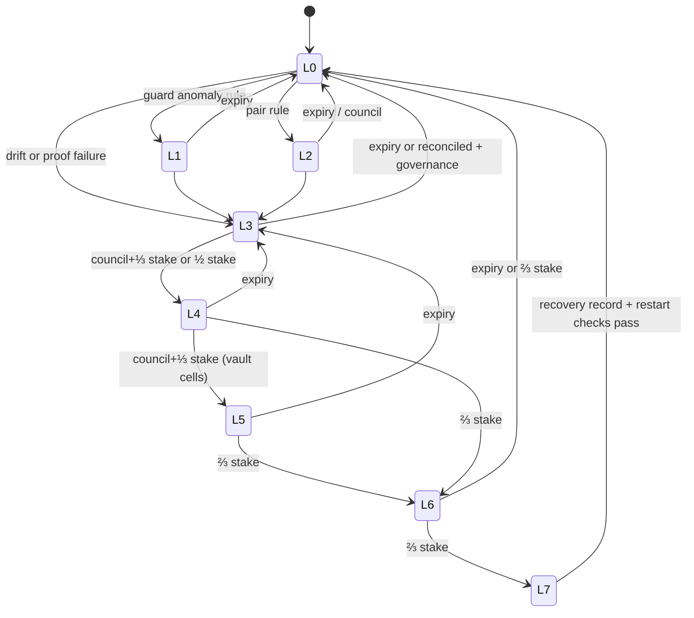

# 03 — Network halt system, systemic risk engine, circuit breakers, recovery

Builds on what exists: the invariant guard and per-module breaker (inv 28, REAL),
the council pause (ADR-050), the upgrade halt (ADR-082, inv 34), guardian recovery
(ADR-056) and the Sentinel Recovery Network (ADR-077 / MIP-0001, accepted,
post-mainnet). The brief's eight levels map onto ADR-077's T1–T5 as below; this
file is the finer-grained specification. Every consensus part ships at
`u64::MAX` until Eric writes an activation height.

## 1. Principles

1. **Scoped:** a level applies to a *cell* (module, pair, route, vault, contract),
   never to the whole ledger below L6.
2. **Transfers survive:** native transfers ≤ `T_small` (governed) succeed at every
   level up to and including L6 (proposed P-5).
3. **Every level expires.** No record without an expiry height (P-3). Renewal needs
   the same authority as raising.
4. **Who may raise:** integer rules up to L3; stake-backed signatures above.
   ML and humans *propose*, never act.
5. **Forward-only:** no finalized block is reverted, ever (P-4). "Timed rollback
   prevention" = there is no rollback to time.
6. **Determinism:** inputs are committed state + the block. No clock, no config.

## 2. Levels

| Level | Name | Effect on the cell | Raised by | Max duration (TARGET defaults, governed) | Lowered by |
|---|---|---|---|---|---|
| L0 | Observe | none; alert published | any sentinel (off-chain, signed) | n/a | n/a |
| L1 | Module quarantine | module rejects new txs of its kinds | guard anomaly rule (exists: `BREAKER_BLOCKS` = 100) | 100 blocks | expiry |
| L2 | Partial trading suspension | per-pair: new orders refused, cancels allowed | integer rule on pair (price-move vs depth, see §4) | 600 blocks | expiry, or council |
| L3 | Chain isolation | one cross-chain route: no new inbound mints, outbound refunds only | reconciler drift > 0 (02 §6), proof failure, foreign reorg beyond confirmations | 7,200 blocks | expiry, or governance after reconcile |
| L4 | Settlement restriction | cell behind the DMZ gateway pays out only to original depositors, throttled | council 2-of-3 **and** ≥⅓ stake, or ≥½ stake | 14,400 blocks | expiry or same authority |
| L5 | Vault freeze | named vault: outgoing blocked; incoming refunded | council **and** ≥⅓ stake | 14,400 blocks | expiry or same authority |
| L6 | Network emergency | all non-ledger modules at L1; transfers ≤ `T_small` continue; larger transfers delayed by vault-style window | ≥⅔ stake | 28,800 blocks | expiry or ≥⅔ stake |
| L7 | Recovery mode | only recovery transactions (forward-only, ADR-077) + small transfers; then controlled restart | ≥⅔ stake, after L6 | until recovery tx executes | recovery completion record |

Durations are block counts (heights), never time (inv 9 spirit).

## 3. Halt state machine (per cell)



Network-wide view: the network level is `max` over cells only for L6/L7; below
that, levels stay per cell.

## 4. Detection sources

| Source | Kind | Can raise directly | Example |
|---|---|---|---|
| Invariant guard | consensus, integer | L1 | conservation off by any unit → block refused; module anomaly → L1 |
| Validator detection | consensus, signed | L4+ (with stake) | validators sign a `HaltAction` |
| Consensus detection | consensus, integer | L3 (routes), L6 proposal | equivocation evidence, certificate gaps |
| Economic anomaly | consensus, integer | L2 | per-pair move > `k` bps of depth within `w` blocks |
| Cryptographic anomaly | consensus, integer + governance | suite sunset (ADR-082 emergency flag) | a suite announced broken → emergency sunset path |
| Cross-chain anomaly | consensus, integer | L3 | reconciler drift; foreign reorg deeper than `min_confirmations` |
| Monitoring | off-chain | L0 | ntfy alerts, status app halt detection |
| ML anomaly | off-chain, advisory | L0 only | sentinel model scores; publishes signed alert; humans/validators decide |

## 5. Pseudocode (deterministic part)

```rust
// Runs inside stage_block after apply + guard. Pure: (committed state, block) -> records.
fn update_levels(state: &State, block: &Block) -> Vec<HaltRecord> {
    let h = block.height;
    let mut out = Vec::new();
    for cell in state.cells_in_fixed_order() {            // fixed order: inv 28
        let cur = state.level(cell);                        // expired records read as L0
        let rule = rule_level(state, block, cell);          // integer rules, ≤ L3
        let act = block.halt_actions_for(cell)              // stake-signed actions
            .filter(|a| a.verify(state.stake_at(h), state.chain_id()))
            .map(|a| a.level)
            .max();
        let target = max(rule, act.unwrap_or(L0));
        if target > cur.level || (target == cur.level && act.is_some()) {
            out.push(HaltRecord { cell, level: target, expires: h + max_dur(target) });
        }
    }
    out
}

fn tx_allowed(state: &State, tx: &Tx) -> bool {
    if tx.is_transfer() && tx.amount() <= state.t_small() { return true; } // P-5
    let lvl = state.effective_level_for(tx);               // max(cell level, network L6/L7)
    match lvl {
        L0 => true,
        L1 => !tx.kind_in(module_of_cell),
        L2 => tx.is_cancel(),
        L3 | L4 => tx.is_refund_to_original_depositor(),
        L5 => tx.is_incoming_refund(),
        L6 => tx.is_transfer_delayed_window() || tx.is_cancel() || tx.is_refund_to_original_depositor(),
        L7 => tx.is_recovery() || tx.is_cancel(),
    }
}
```

## 6. Recovery process and controlled restart

1. **Freeze scope** at the lowest level that contains the incident.
2. **Evidence:** sentinels and operators file signed evidence (threat-intel model).
3. **Recovery transaction** (ADR-077 forward-only): a governance-passed state
   change at a *new* height that moves funds by rule (e.g., refund from a quarantined
   cell to original depositors). It never edits a past block.
4. **Recovery validation:** every node re-executes the recovery tx; the guard
   checks conservation; a mismatch refuses the block like any other.
5. **Controlled restart** (if L7 involved a binary change): ADR-082 schedule entry
   at height H with compiled lead; nodes on the old version halt at H (inv 34);
   operators upgrade; rejoin by certificates (ADR-052) and attested checkpoints
   (ADR-038, ADR-043).
6. **Post-incident:** the exploit becomes an `exploit_replays.rs` test before the
   level is lowered.

## 7. Threat model of the halt system itself

| Attack | Defence |
|---|---|
| Trip a breaker cheaply to grief | floors and tolerances so a breaker cannot be bought (inv 28 `SHIELDED_DRAIN_FLOOR` pattern); per-rule minimum value |
| Use halts to censor | scoped cells; transfers ≤ `T_small` never stop; all levels expire |
| Captured council | council alone reaches nothing above L2; L4+ also needs stake |
| ⅔ stake cartel | can already break safety; L7 cannot revert finality; social recovery out of scope |
| Halt used to hide theft | refunds only to original depositors (P-8) |
| Split from non-deterministic trigger | only committed state + block; fixed order; integer math |
| Never-ending emergency | every record expires; renewal costs the same authority |

## 8. Security arguments (proof objectives; mechanized proofs are 05 §5 work)

- **S1 Safety of levels:** levels are state records written only through
  `update_levels`, which is deterministic; all honest nodes compute the same levels
  (follows from inv 24 + P-7 + fixed order).
- **S2 Bounded censorship:** for any level < L7, a transfer ≤ `T_small` with a valid
  signature and fee is admitted (P-5); proof by case analysis of `tx_allowed`.
- **S3 No rollback:** no code path writes a height < current; recovery txs are
  ordinary txs at the tip (P-4).
- **S4 Liveness of de-escalation:** every record has `expires` (P-3) and
  `effective_level` treats expired as L0, so without fresh authority every cell
  returns to L0 within `max_dur(L6)` blocks.

## 9. Systemic risk engine

Integer, in state (`g:risk:`), recomputed once per epoch from committed state only
(P-7). Each component is in basis points (0–10,000).

| Component | Formula (integer) | Data source |
|---|---|---|
| Vault solvency | `10_000 − min(10_000, assets·10_000 / liabilities)` | vault + bridge books |
| Liquidity concentration | HHI of DEX depth across top LPs, bps | dex state |
| Validator concentration | stake HHI and Nakamoto coefficient vs ⅓ | staking |
| Chain dependency | share of bridged supply per foreign chain | bridge books |
| Signer participation (TSS) | missed custody rounds / rounds in epoch | custody records |
| Bridge exposure | `minted_in_epoch · 10_000 / cap` | bridge books |
| Oracle risk | blocks since last fresh price, oracle sources disagreeing | oracle state |
| Governance risk | stake voting share of top 3 voters; pending param changes touching inv 12 values | governance |
| Economic attack | fee spike vs median (base fee ADR-076) | fee market |
| Market stress | only when oracle fresh: price move per epoch | oracle (optional) |
| Reorg probability | certificate gaps, equivocation evidence count, committee below floor | consensus |

**Composite** = max of weighted components (max, not mean: one red light is red).

**Automatic behaviour** (each a governed table, integers):

| Composite | Behaviour change |
|---|---|
| < 3,000 | normal |
| 3,000–5,999 | bridge epoch caps × ½; exit throttle window × 2; new bridge routes refused |
| 6,000–7,999 | caps × ¼; unbonding period × 2 (stake flight brake); L2 thresholds tightened |
| ≥ 8,000 | affected routes to L3 automatically; propose L4 to validators (they sign or not) |

Off-chain, the same components feed the dashboard and the ML sentinel, which may
publish an L0 alert but cannot change the table.
