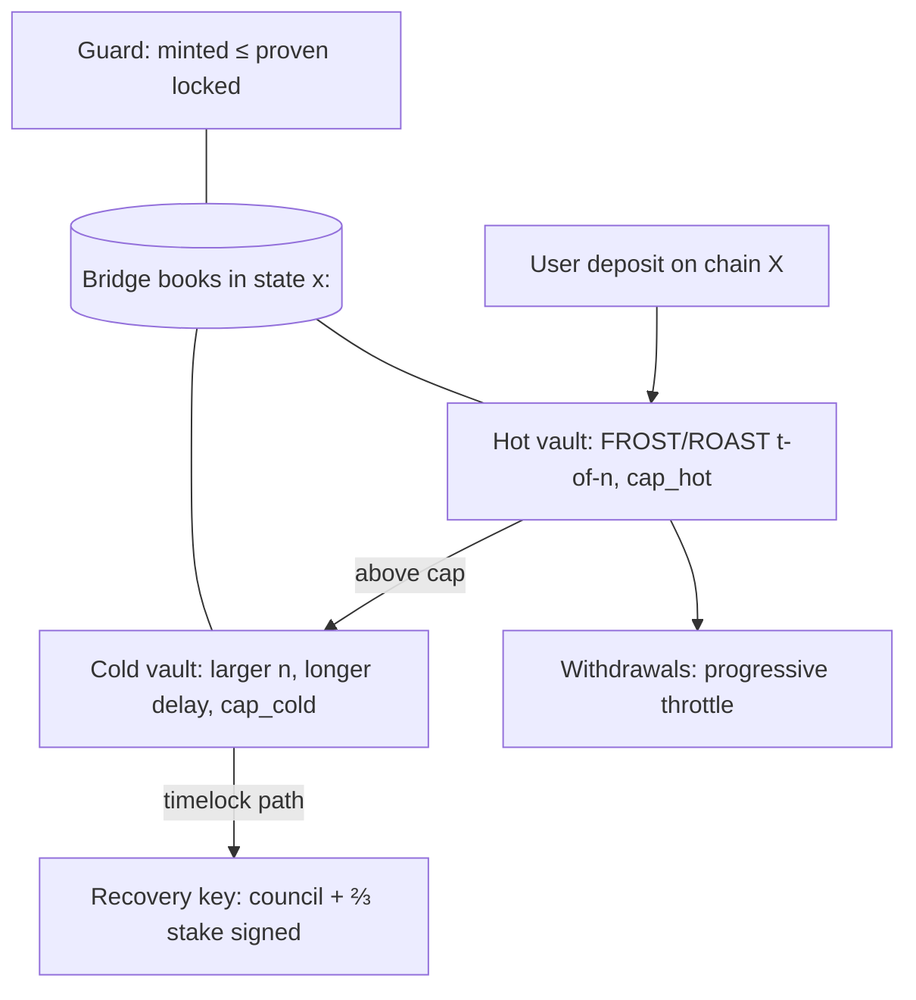

# 04 — Cryptographic stack, TSS, vaults, post-quantum strategy, consensus, performance

## 1. Two different signing problems

The brief's candidate list (FROST, ROAST, GG20, MuSig2, BLS threshold, threshold
EdDSA, threshold Schnorr) is entirely elliptic-curve or pairing based, so every one
of them is broken by a large quantum computer (Shor). That decides the split:

| Problem | What signs | Choice |
|---|---|---|
| **A. Maya2C's own chain** (txs, validator votes, council) | ML-DSA + SLH-DSA hybrid (inv 29–31), ML-DSA-87 validator keys | **Keep PQ. None of the seven candidates is used on our chain.** |
| **B. Custody of assets on foreign chains** (future bridges, ADR-065 option 2) | Whatever the foreign chain verifies: secp256k1 ECDSA, BIP-340 Schnorr, Ed25519 | **A threshold scheme is required here**, chosen below |

Problem A has no threshold construction today (inv 18: no threshold SLH-DSA at
all, no partial-signature API in `fips204`); `custody-mpc` therefore protects the
32-byte chain key with VSS and reconstructs once per signature, checked against the
commitment (inv 18, 19). That stays.

## 2. Evaluation for problem B

Facts are from the cited specifications and papers (not re-verified 2026-11-08).

| Scheme | Spec | Signing rounds | Robust to non-responders | Known issues | Fits chains |
|---|---|---|---|---|---|
| FROST | RFC 9591 (2024) | 2 (1 online with preprocessing) | No — one silent signer aborts the session | — | Schnorr (BIP-340 via secp256k1 variant), Ed25519, Ed448 |
| ROAST | Ruffing et al., CCS 2022 | wraps FROST; runs concurrent sessions | **Yes**: guarantees a signature if ≥ t honest responsive signers, after at most n−t+1 sessions | — | as FROST |
| GG20 | Gennaro–Goldfeder 2020 | many (≥4, more with identifiable abort) | Identifiable abort | Implementation flaws disclosed 2023 (e.g. TSSHOCK, BitForge) across GG18/GG20 libraries; heavy Paillier proofs | ECDSA |
| DKLs23 | Doerner–Kondi–Lee–shelat, IEEE S&P 2024 | 3 | Abort, restart | Newer; fewer independent implementations | ECDSA |
| MuSig2 | BIP-327 | 2 | n-of-n only; any missing signer blocks | — | BIP-340 Schnorr |
| BLS threshold | BLS12-381, non-interactive | 1 (non-interactive aggregation) | Yes (any t shares) | Needs pairings: not verifiable on Bitcoin; not PQ | Chains with BLS precompiles |
| Threshold EdDSA | FROST-Ed25519 (RFC 9591) | 2 | via ROAST | Naïve deterministic-nonce threshold EdDSA is insecure; must use FROST | Ed25519 chains |

### 2.1 Selection

- **Schnorr and EdDSA chains: FROST (RFC 9591) under ROAST.** Two rounds with one
  online round; ROAST turns "one silent signer aborts" into a liveness guarantee with
  t honest signers. Bandwidth per signature is O(n) small messages (commitments 2×33 B,
  shares 32 B per signer).
- **ECDSA chains: DKLs23**, not GG20. Fewer rounds, no Paillier, and GG-family
  implementation history argues against it. Bounded by the per-epoch cap regardless.
- **MuSig2** only for 2-of-2 operational channels (e.g. hot/cold co-sign), never for
  vaults (n-of-n is a liveness trap).
- **BLS threshold** rejected: not verifiable on the main target chains, and pairing
  security is not PQ.

### 2.2 Mathematical justification (the parts that matter)

- **Unforgeability:** FROST is EUF-CMA under the discrete-log assumption in the ROM
  with t−1 corrupt signers (RFC 9591 security considerations; Komlo–Goldberg).
  ROAST preserves it (it only schedules FROST sessions).
- **Liveness under faults:** ROAST: with n signers, threshold t, and at most n−t
  faulty, a signature is produced after at most n−t+1 sessions (Ruffing et al.).
  Choose `t = ⌊2n/3⌋+1`: theft needs t shares (more than ⅔ of signers), and
  liveness survives up to n−t silent signers (just under ⅓).
- **Compromise impact:** with caps, the worst theft per epoch is `cap_epoch` even
  with t shares stolen; detection (reconciler drift, 02 §6) raises L3 within one epoch.

### 2.3 Latency, bandwidth, failure modes, rotation, recovery

| Property | FROST/ROAST design |
|---|---|
| Latency | one online round after preprocessing; network RTT-bound (COMPUTED: ~1 RTT + verification) |
| Bandwidth | per signer per signature: 1 commitment pair + 1 share ≈ 100 B (COMPUTED from 33/32-byte encodings) |
| Failure modes | silent signer (ROAST handles), malicious share (identifiable: share verification per RFC 9591), nonce reuse (preprocessed nonces single-use, zeroized after use) |
| Key rotation | **proactive refresh** each epoch (shares re-randomized, group key unchanged); full **re-key** (new group key + asset sweep) on committee change beyond a threshold |
| Recovery | lost share: refresh from t holders; lost group key ≥ n−t+1 shares: assets stuck → sweep impossible; mitigated by caps and by timelocked recovery script path on Bitcoin (Taproot) to a council+stake controlled key |
| Scalability | n up to ~100 signers practical per vault; more vaults (sharded custody), not bigger ones |

## 3. Vault architecture (foreign assets)

- **Tiered vaults** (hot/cold) with per-tier caps; the hot tier holds ≤ one epoch of
  expected outflow (governed).
- **Distinct operators per share**; no operator holds more than one share per vault.
- **Signers bonded**: each custody signer is a staked validator; misbehaviour
  (proven bad share, missed rounds beyond tolerance) is slashable.
- **Exposure bound (price-independent form):** `cap_epoch(route)` in the foreign
  asset's own units, governed, plus a stake-coupled bound when the oracle is fresh
  (05 §1).
- **Vault churn:** rotation sweeps happen in batches throttled by the same exit
  throttle, so a churn cannot itself be a drain.

## 4. Post-quantum strategy

Already in the tree: suite registry and hybrid (inv 29, 30), suite-tagged txs
(inv 31), scheduled and emergency suite sunsets with compiled leads (ADR-082, inv 34),
ML-KEM-1024 + dual-KEM transport (ADR-009), quantum harbor binding (ADR-055).

| Phase | What | Trigger |
|---|---|---|
| P0 (now) | Hybrid ML-DSA-65 + SLH-DSA for txs, ML-DSA-87 validators, ML-KEM transport | done |
| P1 | Rehearse a suite sunset end-to-end on testnet (announce → sunset height → old suite refused) | before or soon after mainnet |
| P2 | Add a second, structurally different PQ signature to the registry (e.g. an FN-DSA / Falcon parameter set when FIPS 206 is final) so one lattice break is not total | FIPS 206 final |
| P3 | Foreign-chain custody migration: move vaults to PQ outputs where a chain offers them (e.g. Bitcoin PQ output-type proposals) | per chain |
| P4 | Threshold PQ signing for our own keys (lattice threshold schemes exist in the literature; none is standardized) | standardization + review |
| Emergency | One suite broken: council emergency sunset flag (ADR-082); accounts migrate via a signed key-rotation tx under the surviving half of the hybrid | announcement of a break |

**Compatibility layer:** a hybrid signature verifies only if both halves verify; a
sunset of one suite leaves accounts able to rotate using the other, which is the
reason the hybrid exists.

## 5. Consensus design (DAG-BFT) and scaling validator count

Today: DAG-BFT (ADR-027), stake-weighted committee (ADR-040), `MAX_COMMITTEE = 100`,
n−f quorum (ADR-039), attested checkpoints (ADR-038), committee floor (ADR-070).

**Bottleneck — COMPUTED.** If a certificate carries 2f+1 ML-DSA-87 signatures:
`67 × 4,627 B = 310,009 B` per certificate. A node receiving all 100 certificates of a
round receives ≈ 31.0 MB per round. At 3 rounds/s (needed for sub-second commit
with a 2–3 round commit rule) ≈ 93 MB/s per node, before transactions.

**Redesign — lazy certificates** (consensus change: ADR + Eric, post-mainnet):

- A vote is sent once, to the proposer (`100 × 4,627 B ≈ 463 KB` in and out per node
  per round, COMPUTED).
- A certificate carries the vertex digest, a 13-byte signer bitmap and 67 vote
  digests (32 B): `≈ 2,157 B`, ≈ 144× smaller (COMPUTED).
- A node accepts a certificate if it holds or fetches the referenced votes; a
  certificate whose votes cannot be produced on request within `k` rounds is treated
  as absent (no safety change: safety rests on the votes, which are signed).
- Per node per round ≈ 0.68 MB → ≈ 2 MB/s at 3 rounds/s (COMPUTED).

**Committee growth:** committee of `c` drawn by stake each epoch (ADR-040) from an
unlimited staker set; `c` raised only when the bandwidth computation above, re-run
for `c`, fits the target node profile. Rough plan: 100 → 300 (lazy certs) → 1,000
(STARK-aggregated vote proofs, research).

## 6. Performance

### 6.1 Measured today

| Figure | Value | Source |
|---|---|---|
| Finalized transfers/s, 4 validators, one machine | 502.2 | `reports/bench/tps-1793027291.md` (23a158f4) |
| Same, shared machine | 31.3; 3,013 of 6,000 accepted finalized | `reports/bench/tps-1794112649.md` (6029a4ba) |
| Single-thread verify | ≈1 ms/tx (~1,010/s) | `reports/12-baseline.md:34-36` |
| Apply | 942 tx/s | same |
| Finality latency | MISSING | ADR-059 method exists |

### 6.2 Ceilings (COMPUTED)

- Signature bytes per tx: 3,309 + 7,856 = 11,165 B. At 10,000 tx/s that is 112 MB/s
  of signatures alone — **signature size, not CPU, is the long-term ceiling**.
- Verify CPU: 24 logical cores × ~1,010/s ≈ 24k/s if verification parallelizes
  perfectly (unmeasured; parallel exec is RESEARCH).

### 6.3 Targets (TARGET, not claims; each needs a `reports/bench/` file to count)

| Horizon | Finalized TPS (transfers, ≥4 separate machines, WAN) | Finality p50 | Committee | Key dependency |
|---|---|---|---|---|
| 1 year | 2,000 | < 2 s | 100 | parallel verify on apply path; P0 regression fixed |
| 5 years | 20,000 | < 1 s | 300 | lazy certs; parallel execution promoted; block-level signature batching |
| 10 years | 100,000 | < 500 ms | 1,000 | STARK aggregation of tx signatures per block (removes the 112 MB/s ceiling); stateless validation |
| 25 years | set from then-current hardware; the rule is "bandwidth per validator ≤ consumer link" | < 250 ms | ≥ 1,000 | sharded execution (blockgraph, RESEARCH) |

State and storage: pruning with verified copies (inv 27); state growth bounded by
rent or deposits is a research row (05 §7).
