# Diagrams

Five pictures of Maya2C, each in two forms: a hand-drawn SVG in the Forged
Light palette (teal `#2cc3cf`, bronze `#d9b97a`, steel `#b9c6ca` on abyss
`#050b0f`) for the README and the site, and a Mermaid source below that GitHub
renders and anyone can edit in a pull request.

Every box names a real crate, file or function. When the code moves, change
the Mermaid source and the SVG in the same pull request. The status chips in
the ecosystem map are `features.toml` values; change them when the ledger
changes, never ahead of it.

| Diagram | SVG | Checked against |
|---|---|---|
| System architecture | [architecture.svg](architecture.svg) | `crates/node/src/{network,rpc,state}`, `crates/dag-bft`, `crates/vm`, `crates/api-gateway` |
| Transaction lifecycle | [tx-lifecycle.svg](tx-lifecycle.svg) | `HybridVerifyingKey::verify` (`crates/node/src/crypto/hybrid.rs`), `Mempool::insert`, `StateDB::apply_block_journaled` |
| Trust boundaries | [trust-boundaries.svg](trust-boundaries.svg) | `crates/api-gateway/src/allowlist.rs`, `crates/node/src/rpc/limit.rs`, `crates/dos-guard`, `docs/pq-transport.md`, `bins/maya2c-signer` |
| Ecosystem map | [ecosystem.svg](ecosystem.svg) | `features.toml` subsystem entries for each app |
| Milestone ladder | [roadmap.svg](roadmap.svg) | [docs/MISSION.md](../MISSION.md), [ADR-042](../adr/ADR-042-solo-launch-path.md) |

## System architecture

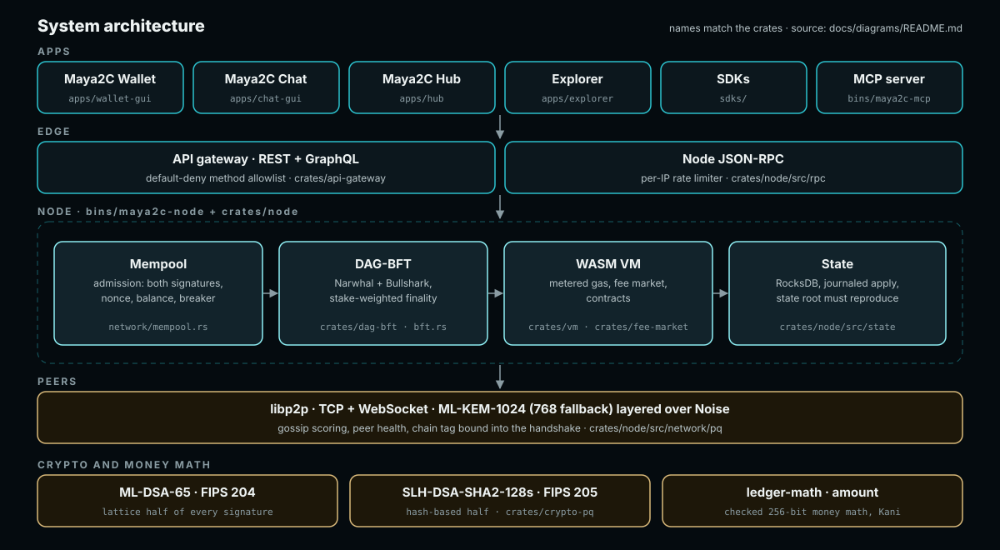

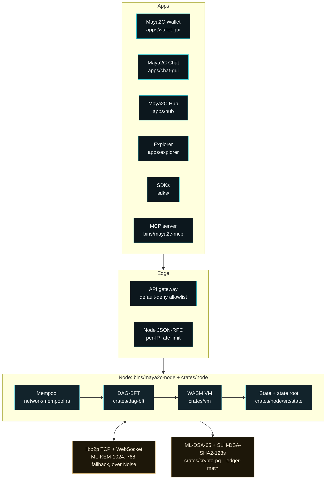

## Transaction lifecycle

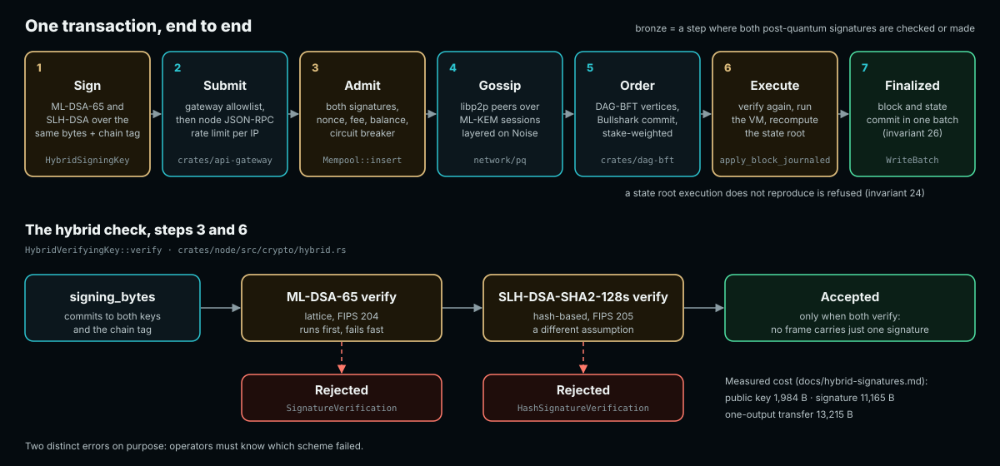

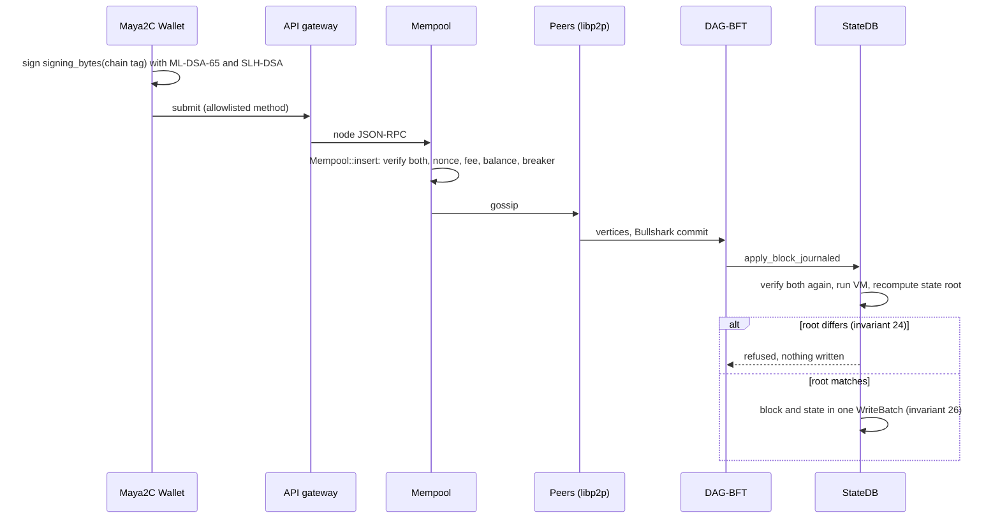

The hybrid check inside `HybridVerifyingKey::verify`:

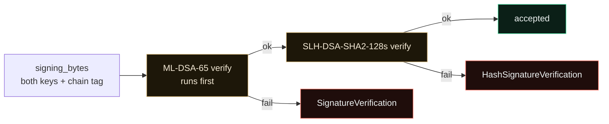

## Trust boundaries

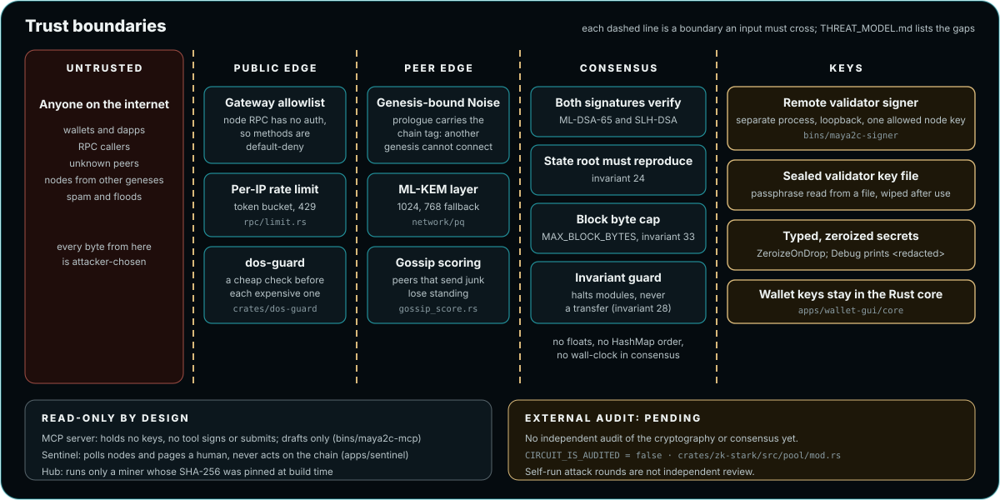

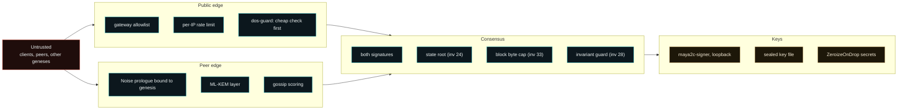

External audit: pending. `CIRCUIT_IS_AUDITED = false` in
`crates/zk-stark/src/pool/mod.rs`.

## Ecosystem map

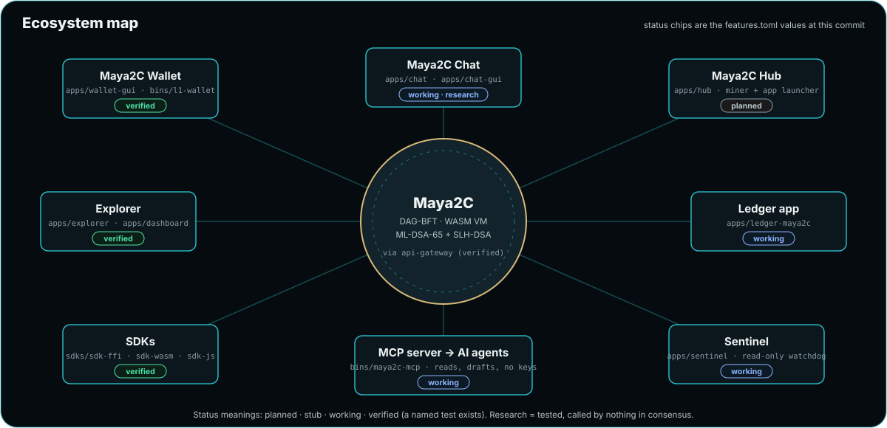

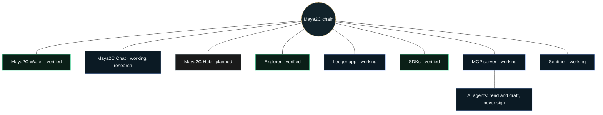

## Milestone ladder

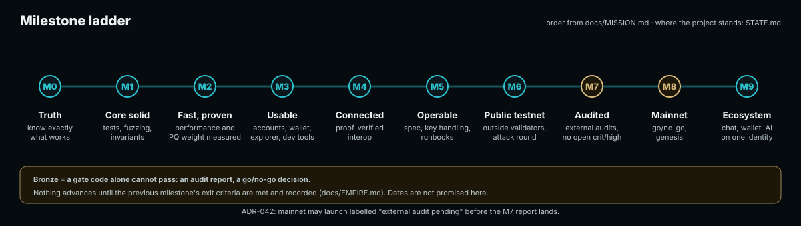

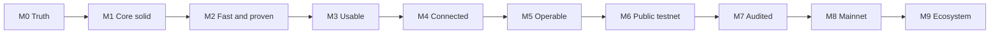

[ADR-042](../adr/ADR-042-solo-launch-path.md) allows mainnet to launch
labelled "external audit pending" before the M7 report lands. Where the
project stands now: [STATE.md](../../STATE.md).
