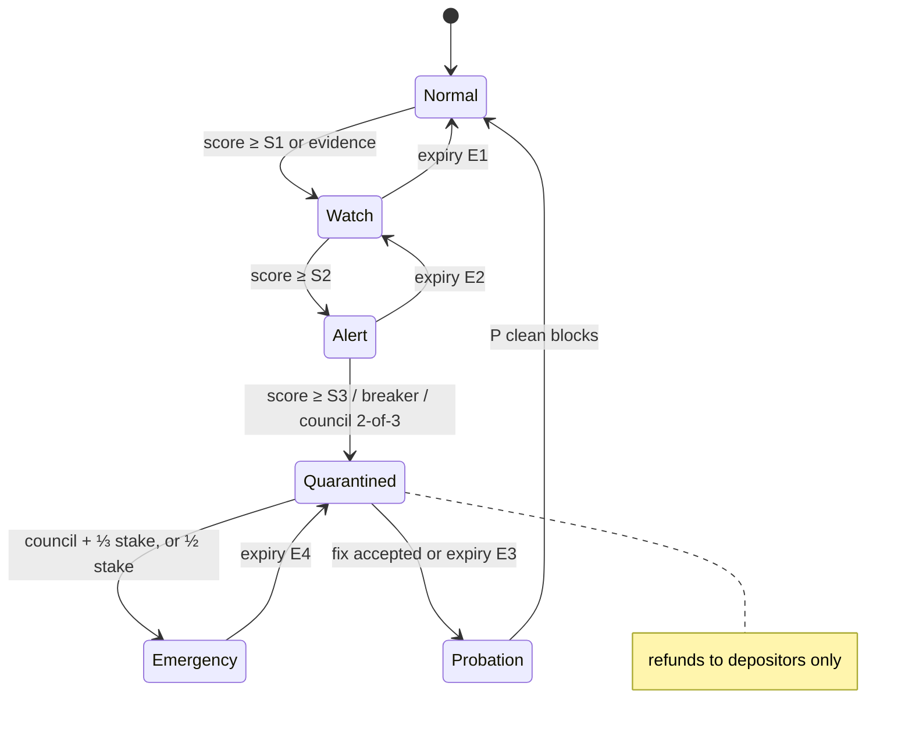
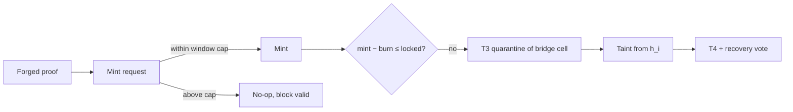

# MIP-0001: Maya2C Sentinel Recovery Network (SRN)

| Field | Value |
|---|---|
| Status | **Proposed**, 2026-11-02. Design only. No code, no activation height. |
| Requested by | Eric, 2026-11-02 ("do the upgrade I tell you now and also document it everywhere") |
| Decision record | [ADR-077](../adr/ADR-077-sentinel-recovery-network.md) |
| Prior art | [docs/prior-art/chain-level-exploit-recovery.md](../prior-art/chain-level-exploit-recovery.md), searched 2026-11-02 |
| Scope | After mainnet. Nothing here enters the launch binary (ADR-016, ADR-069). Every consensus part ships behind an activation height of `u64::MAX` until its own spec rules, vectors, tests and reviews exist. |
| Reality ledger | `features.toml` subsystem `sentinel-recovery-network`: RESEARCH / planned |

---

## 0. Summary

Bridges, contract bugs, stolen validator keys, oracle manipulation and exchange
compromises cost the industry billions every year. Most chains respond in one of
two ways. Some do nothing, because the ledger is immutable. Others act ad hoc:
validators halt, a foundation ships an emergency fork, and the community argues
about legitimacy afterwards. Sui with Cetus (May 2025), Berachain with Balancer
(Nov 2025), Flow (Dec 2025) and BNB Chain (Oct 2022) are recent cases (the
prior-art record lists them).

SRN makes incident response a **protocol rule instead of an improvisation.**
Detection, containment and recovery all happen through on-chain transactions,
and every power is bounded, time-limited, evidence-gated and public.

It has six layers:

1. **Sentinel layer** (off-chain): any node can run detectors, including ML
   models. Sentinels publish signed alerts. They are advisory only.
2. **Evidence and threat level** (consensus, deterministic): integer rules
   computed at apply turn verifiable evidence into a threat level, T1 to T5.
3. **Containment, the Security DMZ** (consensus): a compromised module,
   contract or bridge is quarantined as a cell. The native ledger keeps
   running.
4. **Safe mode** (consensus): network-wide restrictions, only at T5, bounded in
   time, renewed only by a rising quorum.
5. **Governed recovery** (consensus): a **forward** restitution transition. It
   is applied at a future height, touches only balances tainted by the
   incident, and is approved by a bicameral, adaptive supermajority after a
   public challenge window.
6. **Learning layer** (off-chain): an incident corpus, detector updates and
   signed advisories. AI never holds a key and never triggers a consensus
   action.

### 0.1 Where this design departs from the brief, and why

The brief was reviewed against the chain's recorded invariants and against what
went wrong elsewhere. These changes are deliberate, and each one is a decision
for Eric (§13).

| Brief asked for | This design does | Why |
|---|---|---|
| Rollback to a checkpoint | **No rewind of finalized blocks.** Recovery is a forward state transition at a future height. | Finality is what exchanges, bridges and users act on. A rewind silently reverses honest transactions made after the incident, including deposits already credited elsewhere. Flow proposed exactly this in December 2025, faced partner backlash, and switched to "isolated recovery". DAG-BFT finality (ADR-027) and invariant 24 assume committed state is final. |
| AI anomaly detection drives safe mode | AI is **advisory only**. Only deterministic integer rules in consensus can raise a threat level automatically, and they stop at T3. | Invariant 20: no float enters a consensus rule. Two honest nodes must compute the same level from the same blocks. A model's output is not reproducible evidence. |
| Freeze contracts, bridges, withdrawals and large transfers network-wide | **Scoped quarantine per cell** (DMZ). Plain native transfers below a threshold never freeze. Network-wide safe mode exists only at T5. | This is the invariant guard's founding rule ([invariant-guard.md](../invariant-guard.md)): an anomaly stops the module it alarmed, never a transfer. Freezing everyone to stop one drain turns every false positive into a chain halt. |
| 80% / 90% validator approval | A **bicameral, adaptive** threshold: validators at ⅔ stake rising to 90%, plus a holder veto, plus a timelock and a challenge window. The recovery layer stays off until the validator set passes an independence floor. | The launch validator set runs on one PC (ADR-047), so any validator-vote power is, at launch, the owner's power. Calling that decentralized recovery would be false. |
| Organizations that cause catastrophic bugs pay penalties | Penalties apply only to **posted bonds** (a Sentinel Bond that an app, bridge or exchange posts to earn "covered" status). Unbonded parties can be quarantined, not fined. | A protocol cannot charge someone who holds no stake in it. A fine without collateral is a statement, not a mechanism. |
| Validator lockdown | During T4 and above: no unbonding, no committee change, no stake withdrawal. Emergency key rotation stays open. | An attacker holding stolen validator keys must not be able to exit before slashing. An honest operator must still be able to rotate a stolen key. |
| A world-leading, never-before-done result | Not claimed. | Chain-level freezes, governed fund returns, per-message circuit breakers and decentralized ML detection all exist elsewhere (prior-art record). The defensible difference is that SRN is one written, bounded, on-chain rulebook rather than an emergency improvised under pressure. Standing Order 10 applies. |
| ADR-050 says the council "cannot freeze balances" | SRN would freeze **tainted** balances under a bicameral vote, never through the council alone. | This amends ADR-050's stance and needs Eric's explicit decision (D1). The council's power (pause one module, bounded) is unchanged. |

---

## 1. Motivation

| Failure class | Example shape | What a pure-immutability chain can do |
|---|---|---|
| Bridge proof forgery | attacker mints wrapped assets without a lock | nothing on chain; issuers blacklist off chain |
| Contract logic bug | a pool's invariant breaks and it is drained in a few blocks | nothing; a fork if the community insists |
| Validator compromise | stolen keys, equivocation, takeover attempt | slashing (if evidence exists) |
| Governance attack | a malicious proposal with borrowed voting power | depends on timelocks |
| Oracle manipulation | a price pushed for one block, loans liquidated | nothing |
| Exchange compromise | hot wallet drained, funds bridged out | nothing on chain |

The common pattern: **the drain takes minutes, the response takes days, and the
response has no rules.** SRN shortens the first gap by containing early, and
replaces the second with a procedure written down before any incident.

---

## 2. What already exists in this tree

SRN is mostly a composition of parts that exist, plus four new ones.

| Part | Where | Status (features.toml) | Role in SRN |
|---|---|---|---|
| Invariant guard + per-module circuit breaker | `crates/node/src/state/invariant_guard/` | REAL / verified (invariant 28) | Conservation failure makes a block invalid. An anomaly halts one module for 100 blocks. This **is** SRN's T2/T3 automatic containment for native modules. |
| Security council pause | `crates/node/src/state/council.rs`, ADR-050 | REAL | A 2-of-3 council pauses one module for a bounded time. This becomes SRN's human T3 trigger. |
| Threat-intel registry | `crates/threat-intel`, `threat_exec.rs`, `evidence_tap.rs` | RESEARCH, activation `u64::MAX` | Verifiable, re-checked evidence of network misbehaviour; the model for SRN evidence records. |
| Guardian recovery | ADR-056 | Accepted | Per-account recovery with delay and owner cancel. SRN handles the chain-level case; guardians handle the single-key case. |
| Safety-window payments, duress keys | ADR-069 items 1, 2 | Proposed | Account-level protections that cut the loot available to a drain. |
| Exploit replay suite | `crates/node/tests/exploit_replays.rs` | REAL / verified | The regression home for every SRN scenario in §10. |
| Certificates and checkpoints | ADR-052, block headers carry state roots | REAL | SRN checkpoints reuse the certified state root; nothing new is signed. |
| Snapshots and DR drill | bootstrap snapshot v2, `reports/` DR drill | REAL | Fast restore of a node. Not a ledger rewind. |
| Committee concentration metrics | `staking/concentration.rs` | RESEARCH | Feeds the independence floor (§7.5). |

New in SRN:
- the threat-level state machine;
- the cell (DMZ) model extended to contracts and bridges;
- taint tracking;
- the recovery vote and restitution transition;
- the Sentinel Bond and SRN funds.

---

## 3. Architecture

```
                     OFF-CHAIN                               ON-CHAIN (consensus, deterministic)
 ┌──────────────────────────────────────┐        ┌──────────────────────────────────────────────────────┐
 │ Sentinel nodes (any node, opt-in)     │        │  Evidence records (prefix srn/evidence)               │
 │  - heuristics, ML detectors           │ signed │   hash + verifiable facts (tx ids, roots, equivocation)│
 │  - mempool / bridge / oracle watchers │ alert  │                │                                      │
 │  - exchange hot-wallet watchers       ├───────►│  Deterministic signals at apply (integers only):      │
 │                                       │  (tx)  │   outflow velocity, conservation, oracle deviation,   │
 │ Learning layer                        │        │   bridge mint vs lock, equivocation, gov anomalies    │
 │  - incident corpus, model updates     │        │                │                                      │
 │  - signed advisories to operators     │        │  Threat level machine  T1 ─► T2 ─► T3 ─► T4 ─► T5     │
 └──────────────────────────────────────┘        │   auto ≤ T3 | T4: council or ⅓ stake | T5: ⅔ stake    │
          ▲ advisories only, never keys           │                │                                      │
          │                                       │  Containment (DMZ cells)   Safe mode (T5 only)        │
          │                                       │                │                                      │
          │                                       │  Recovery vote ─► challenge window ─► restitution     │
          └───────────────── incident data ───────┤   (forward transition, tainted balances only)         │
                                                  └──────────────────────────────────────────────────────┘
```

Every arrow into consensus is a **transaction**. Nothing reaches consensus
through a side channel, a node flag or an operator command.

---

## 4. Phase 1: Sentinel intelligence layer

### 4.1 Sentinels

- Any node can run the `sentinel` service (a planned extended-tier binary,
  outside the node's consensus code).
- Running one is free. A **bonded sentinel** posts `SENTINEL_BOND` to earn
  bounties (§9) and to file escalation requests.
- Detectors are plug-ins. They may be heuristics or ML models. Their output is
  an **alert**: a signed message naming a target cell, a detector id, and
  references to on-chain facts.
- Alerts are gossiped. One that names verifiable facts can be submitted as an
  `SrnEvidence` transaction; one that does not is advisory and never reaches
  consensus.

### 4.2 What is detected, and where the signal lives

| Threat | Off-chain detector (advisory) | On-chain deterministic signal (consensus) |
|---|---|---|
| Rapid fund draining | flow-graph anomaly, clustering | **Outflow velocity**: a cell's net outflow over `W` blocks, as a fraction of its holdings in basis points (u256 integer math) |
| Flash exploit | same-block borrow/repay patterns | conservation (exists); per-block outflow cap per cell |
| Smart-contract attack | bytecode similarity to known exploits | contract cell outflow velocity; reentrancy is structurally absent in native modules (exploit replays) |
| Bridge compromise | proof-of-reserve watchers on the other chain | **mint-without-lock**: mints exceed recorded locks plus the window cap |
| Oracle manipulation | cross-venue price comparison | **oracle deviation**: the reported value against the trailing median of N reports, in bps |
| Validator anomaly or takeover | missed rounds, key reuse, timing | **equivocation evidence** (two signed conflicting certificates); a sudden concentration jump from `staking/concentration.rs` |
| Governance attack | voting-power flash borrowing | stake acquired within `G` blocks of the vote counts zero (a rule, not a detector); proposal touching an SRN parameter |
| Economic attack | econ simulator replays | fee-market and DEX invariants (exist) |
| Consensus attack | partition, withholding | certificate gaps, finality lag above `F` rounds |
| Exchange compromise | hot-wallet outflow watchers | only for exchanges registered as cells (§8.4) |
| Coordinated attack | correlation across detectors | escalation rule: two or more independent signals on related cells within `W` blocks |

### 4.3 Threat score and threat levels

The **threat score** is an integer from 0 to 10,000 per cell, computed at apply
from deterministic signals only:

```
score(cell) = min(10_000, Σ_i weight_i × level_i(signal_i))
```

- `level_i` is a step function over integer thresholds.
- Weights and thresholds are governed parameters with hard bounds
  (invariant 13: a governed value is a number, never a program).
- Sentinel alerts **do not add to the score.** They are evidence a human or
  validator may act on.

| Level | Name | Entered by | Automatic actions | Expiry |
|---|---|---|---|---|
| **T1** | Watch | score ≥ `S1`, or one accepted `SrnEvidence` | none; flagged in RPC, explorer and the Hub | `E1` blocks after the last signal |
| **T2** | Alert | score ≥ `S2` | cell outflow rate-limited to `R2` per block; large transfers out of the cell delayed `D2` blocks (cancellable by the sender) | `E2` |
| **T3** | Containment | score ≥ `S3`, a conservation-adjacent anomaly (the breaker), **or** a council 2-of-3 pause | cell **quarantined** (§8); taint tracking starts at the incident height | `E3`, renewable once automatically and then only at T4 |
| **T4** | Emergency | council 2-of-3 **plus** ≥ ⅓ stake attestation, **or** ≥ ½ stake | quarantine widens to cells that received tainted value; validator lockdown; governance execution paused for SRN-sensitive parameters; recovery vote may be opened | `E4`; renewal needs a fresh, higher quorum |
| **T5** | Safe mode | ≥ ⅔ stake, plus accepted evidence of a cross-cell or consensus-level attack | network-wide safe mode (§6) | `E5`, short; renewal at ⅔ again with a new evidence hash, at most `K5` times |

Escalation rules:
- Deterministic rules can raise a level **only up to T3**. T4 and T5 always need
  signatures from stake.
- Levels fall **automatically** at expiry. Keeping a level needs a new act.
- Every level change is a state record with its evidence hash, so the explorer
  shows why each restriction exists and when it ends.
- A cell's level and the network level are separate. Of the five levels, T5
  alone applies network-wide.

---

## 5. Phase 2: Safety checkpoint engine

### 5.1 What checkpoints are for, given no rewind

SRN never restores the ledger to an old state. Checkpoints serve three other
purposes:

1. **The evidence anchor.** Restitution needs provable pre-incident balances.
   A certified state root at or before the incident height gives a Merkle
   proof of every balance in it.
2. **Fast node restore.** A node can rebuild from a snapshot instead of replaying
   from genesis (this exists: bootstrap snapshot v2).
3. **Tamper evidence.** A checkpoint's root is in a certified header, so a
   doctored snapshot fails verification against it.

### 5.2 Design

| Layer | Content | Frequency | Signed by | Cost |
|---|---|---|---|---|
| Header state root | the root of all state after the block | every block (exists) | the block's certificate (DAG-BFT) | none new |
| Certified checkpoint | `(height, state_root, certificate)` | every epoch (exists, ADR-052) | the committee | none new |
| Incremental delta | the undo journal's changed keys between checkpoints | every certified checkpoint | content-addressed (BLAKE3); its hash goes in the next checkpoint record | ∝ keys written per epoch |
| Full snapshot | the whole state as a CAR file (`crates/archive`) | daily, plus at T3 entry | content-addressed; the root it reproduces is certified | ∝ live state size |
| Distribution | snapshots and deltas | on creation | any node serves them; the hash pins them | storage on volunteer nodes |

### 5.3 Frequency tradeoffs

Real figures for state size, delta size and restore time are **MISSING**: no
benchmark has measured them, and none will be invented (Standing Order 2). The
tradeoff is in the formulas:

- Snapshot every `Δt`: storage `≈ snapshot_size × (retention / Δt)`. Restore
  time `≈ load(snapshot) + replay(blocks since snapshot)`.
- A shorter `Δt` means faster restore but more storage and I/O on the producing
  node.
- Since recovery is forward-only, **restore speed matters for node operations,
  not for victims.** Victims' outcome depends on the evidence anchor, and every
  block already has one.

| Interval | Restore replay | Storage | Recommendation |
|---|---|---|---|
| 30 s | shortest | highest; snapshot I/O competes with block production | not recommended |
| 60 s | short | high | not recommended |
| 5 min | moderate | moderate | as **incremental deltas**, not full snapshots |
| epoch | per ADR-052 | low | the certified anchor (exists) |
| daily | longest | lowest | the full snapshot, plus one taken at T3 entry |

---

## 6. Phase 3: Emergency safe mode (T5)

### 6.1 What it does

| Category | During safe mode |
|---|---|
| Smart-contract execution | new calls refused, except calls marked `exit-only` by the contract (withdraw-to-owner paths) |
| Bridges and HTLC | **new** locks and mints refused; refunds and expiries keep working (an escrow that cannot be returned is a confiscation) |
| Large transfers | native transfers above `T_large` delayed `D5` blocks, cancellable by the sender; transfers below `T_large` **never stop** |
| Governance | execution of passed proposals paused; voting continues; SRN emergency transactions continue |
| Withdrawals from module escrows | allowed **to the original depositor**; refused to any other address |
| Validators | lockdown: no unbonding, no stake withdrawal, no committee change; emergency key rotation allowed |
| Peer communication, evidence submission, investigation | always on |
| Emergency governance (SRN votes, challenges, appeals) | always on, with fee priority |

### 6.2 Activation conditions

All four must hold:
1. ≥ ⅔ of active stake signs an `SrnSafeMode` transaction;
2. it references accepted evidence of a cross-cell **or** consensus-level attack;
3. no safe mode ended within the last `C5` blocks (cooldown), unless the new
   evidence names a different attack;
4. the activation height has passed (`SRN_ACTIVATION_HEIGHT`, `u64::MAX` until
   decided).

### 6.3 Preventing abuse, centralization and censorship

- **Time bound.** `E5` blocks, then automatic exit. Each renewal needs ⅔ stake
  again and a new evidence hash, at most `K5` times.
- **No account targeting.** Safe mode is category-based. No address can be
  named in it. Freezing a specific balance happens only through taint (§7.3)
  under a recovery vote.
- **Small transfers never stop.** A user can always move value below
  `T_large`, so safe mode cannot be used to starve the economy or a person.
- **Escrow returns never stop.** Every lock, order and HTLC can still be
  refunded to its owner.
- **Public.** Every activation, renewal and exit is a record with the signer set
  and the evidence hash.
- **Cost.** The proposer posts a bond. If no recovery vote or quarantine follows
  within `E5`, a share of the bond burns (§9).

---

## 7. Phase 4: Consensus-governed recovery

### 7.1 When recovery is possible at all

A recovery proposal is valid only if **all** hold:

| Gate | Rule |
|---|---|
| Loss threshold | the deterministic loss measure (cell outflow during the incident window, minus outflow that went back to depositors) ≥ `max(L_abs, L_rel × cell_holdings_at_anchor)` |
| Containment | the source cell was at T3 or higher during the incident window |
| Evidence | an accepted `SrnEvidence` record whose facts reproduce on every node |
| Taint root | the proposal commits to a **taint root**: a Merkle root of `(account, amount)` pairs derived by the taint rule (§7.3), recomputed and checked by every node |
| Public audit | a challenge window of `A` blocks with no successful challenge (§7.4) |
| Independence floor | the active committee passes the independence floor (§7.5) |

Minor incidents fail the loss threshold, so no vote can even be opened for them.

### 7.2 The restitution transition (forward-only)

When a recovery passes, at height `h_exec` (after the timelock):
1. every tainted balance in the taint root moves from its account into the
   **Recovery Escrow** (a state prefix);
2. victims claim from the escrow against the anchor-height proof of their
   loss, pro rata if the escrow is short;
3. unclaimed amounts after `U` blocks go to the Recovery Fund;
4. **nothing is minted and no untainted account is debited.** The invariant
   guard's conservation check still runs on this block.

### 7.3 Taint rule

Taint starts at the incident height `h_i`, at the quarantined source cell:
- value leaving the source cell after `h_i` is tainted;
- an account receiving tainted value carries taint up to the amount received;
- taint follows value across up to `Hops` transfers. Each hop's taint is
  `min(received_taint, balance)`;
- taint **stops** at cells registered as exit-sinks (e.g. a bridge back to
  another chain). Those are reported in the evidence, not frozen;
- caps: at most `N_taint` accounts and total taint ≤ the loss measure.
  Anything wider is rejected as overreach.

The rule is deterministic, so the taint root is recomputed by every node, and a
proposal whose root differs is invalid.

### 7.4 Public audit and challenge

During the `A`-block window:
- anyone can file a `SrnChallenge` with counter-evidence: an account wrongly
  tainted, a loss mis-measured, or evidence that does not reproduce;
- a challenge that proves a deterministic mismatch **voids** the proposal and
  pays the challenger from the proposer's bond;
- a challenge that argues judgement (not determinism) goes to the vote as a
  recorded objection;
- a tainted account can file an **appeal**. If no recovery passes before the
  freeze expires, it is released automatically.

### 7.5 Independence floor

Recovery is switched off while the committee is controlled by too few parties.
The floor is measured by `staking/concentration.rs`: the Nakamoto coefficient
must be ≥ `N_min` and no operator may hold more than 20% (the mainnet-plan cap).
At launch the set runs on one PC (ADR-047), so **the recovery layer is off at
launch by construction**, and this document says so.

### 7.6 Voting methods compared

| Method | For | Against | Verdict |
|---|---|---|---|
| Fixed 80% validator stake | simple | a cartel of 80% can seize tainted funds; and 21% can block a clear-cut recovery | rejected alone |
| Fixed 90% validator stake | hard to capture | 11% blocks everything, including obvious cases | rejected alone |
| Adaptive validator threshold | the threshold rises with impact | needs an impact measure | **adopted** as the validator house |
| Council only | fast | central; contradicts ADR-050 | rejected for recovery (kept for T3 pause) |
| Token-holder referendum | broad | low turnout; plutocratic; flash-borrowed votes | **adopted only as a veto** |
| Quadratic voting | dampens whales | sybil-trivial without identity | rejected |
| Bicameral (validators approve + holders can veto) | two independent groups must not object | slower | **adopted** |

**Adopted rule.**
- **The validator house approves.** The threshold is ⅔ stake for a recovery
  touching ≤ `N_small` accounts. It rises linearly to 90% at `N_taint`
  accounts, and is 90% whenever any tainted account is itself a cell.
- **The holder house can veto.** Holders vote with balance held since before
  `h_i`, so flash-borrowed weight is zero. ≥ ⅓ of votes cast against, with
  turnout ≥ `Q_min`, rejects the recovery.
- **Timelock.** `h_exec ≥ vote_end + TL`, so anyone who objects can see it
  coming.

---

## 8. Phase 5: Attack containment (the Security DMZ)

### 8.1 Zones

| Zone | Members | Can be quarantined? |
|---|---|---|
| **Core** | native ledger, consensus, staking, fee market | **Never.** A halt here is the BFT halt every chain has: honest validators stop signing. SRN does not add one. |
| **Module cells** | DEX, oracle, VM contracts (each contract a cell), RWA, identity, vault, sealed mempool, channels | yes |
| **Edge cells** | bridges, HTLC routes, registered exchanges and custodians | yes, with extra caps (§8.4) |

### 8.2 Cell boundary

Every value movement into or out of a cell passes through the **settlement
gateway**. Today `settlement.rs` and the mempool already read the breaker; SRN
generalises that gate to a per-cell state. The gateway is the single place that
enforces quarantine, so a missed check elsewhere cannot bypass it (the same
argument the invariant guard makes about `stage_block`).

### 8.3 Quarantine state machine

```
 Normal ──score≥S3 / council──► Quarantined ──fix accepted by governance──► Probation ──P blocks clean──► Normal
   ▲                               │   │                                       │
   │                               │   └──expiry, no renewal──────────────────►│ (back to Normal via Probation)
   └────────────── rollback is never a transition ─────────────────────────────┘
```

| State | Inbound value | Outbound value | Internal calls | Cross-cell calls |
|---|---|---|---|---|
| Normal | yes | yes | yes | yes |
| Quarantined | refused (no new deposits) | **only refunds to the original depositor, by exit queue** | refused | refused |
| Probation | yes, capped | rate-limited to `R_p` per block | yes | allowed to non-quarantined cells |

### 8.4 Edge cells: bridges and exchanges

- **Bridges** have a per-window mint cap, a per-transfer cap, and an
  epoch-by-epoch reserve check (`minted − burned ≤ locked_proof`). A mint above
  the cap is a no-op, not a failed block (invariant 7).
- **Exchanges and custodians** can register their deposit addresses as an edge
  cell, voluntarily. A registered exchange gets T2 delays on large outflows.
  Its users get protection; the exchange gives up instant hot-wallet outflow.
  Unregistered off-chain exchanges are out of SRN's reach. The chain cannot
  see their books.

---

## 9. Phase 6: Self-evolving defense network

### 9.1 What it does

- **Incident corpus:** every SRN incident's evidence, taint graph and outcome,
  public and content-addressed.
- **Detector improvement:** sentinels retrain on the corpus. A new detector is
  published as a versioned artifact with a reproducible build (ADR-054) and a
  model card.
- **Threat-intelligence distribution:** signed advisories (detector id,
  pattern, affected cell kinds) gossiped to operators and shown in the Hub.
- **Deterministic rule updates:** when a pattern is understood well enough to be
  a rule, it becomes an integer signal through governance, with bounds and a
  timelock. The ML model itself never enters consensus.

### 9.2 AI never gets chain control

| Safeguard | How |
|---|---|
| No keys | no SRN component holds a validator, council or treasury key; sentinels sign alerts with their own identity, which carries no power |
| Advisory only | alerts never change a score or a level; only stake signatures and deterministic rules do |
| Deterministic boundary | consensus reads integers from on-chain facts; invariant 20 forbids floats |
| Bounded parameters | a governance change to a weight or threshold must stay within compiled bounds, and SRN parameters need the highest governance tier and a timelock |
| Two-human rule for T4/T5 | stake signatures come from operators, not from software that acts alone |
| Off switch | ignoring advisories is always safe, because nothing depends on them |
| Adversarial testing | every detector update is run against the exploit replay suite and the corpus before advisories cite it |

---

## 10. Phase 7: Economic model

Economics changes are Eric's decisions (CLAUDE.md, "When to stop and ask").
The values below are **proposals**, not settings.

### 10.1 Actors and incentives

| Actor | Rewarded for | Penalised for |
|---|---|---|
| Bonded sentinel | evidence that leads to an accepted quarantine or recovery (bounty from the Sentinel Fund) | escalation requests that expire with no action (a share of the bond burns, rising with repeats) |
| Validator | signing correct T4/T5 acts and recovery votes (no extra reward beyond fees; avoids paying for activism) | equivocation (slashing, exists); signing safe mode that is later voided by a deterministic challenge (a slash proportional to stake) |
| Covered app, bridge or exchange (Sentinel Bond posted) | "covered" status and insurance eligibility | a recovery caused by its own cell slashes its bond **first**, up to the bond, before the Recovery Fund pays |
| Attacker | — | taint freeze; slashing if a validator; loss of any posted bond |
| Challenger | a successful deterministic challenge (paid from the proposer's bond) | a challenge that fails determinism costs its fee |

### 10.2 Funds

| Fund | Source (proposal) | Use | Controls |
|---|---|---|---|
| Sentinel Fund | `x` bps of fees | bounties | per-incident cap, paid only on acceptance |
| Insurance Pool | premiums from covered cells | top up restitution when the escrow is short | coverage cap per cell; pro rata |
| Recovery Fund | unclaimed restitution, burned bond shares, slashed stake share | restitution shortfalls after insurance | spend only through a passed recovery |
| Emergency Stabilization Treasury | governance allocation | operational incident costs (investigation, audits) | timelocked, per-epoch cap, holder veto |

### 10.3 Game theory

- **Attacker's expected value.** With loot `L`, success probability `p_s`,
  containment-before-exit fraction `c`, recovery probability `p_r` and cost
  `K`, the expected value is:

  ```
  EV = p_s · L · (1 − c) · (1 − p_r) + p_s · L · c · 0 − K
  ```

  SRN works by raising `c` (containment speed) and `p_r`. Neither value has been
  measured. Both are **MISSING** until the attacknet runs SRN scenarios.
- **Griefing.** A sentinel or validator might escalate to hurt a competitor's
  cell. The deterrent holds when the expected bond loss is larger than the
  griefing gain: `b · (1 − p_accept) > G`. Expiry and probation cap `G` at
  `E3` blocks of the cell's activity.
- **Captured supermajority.** A ⅔ cartel that tries to label honest funds
  "tainted" must produce a taint root that every node recomputes from
  deterministic rules. A false one is invalid, not merely contested. The
  remaining risk is a cartel that **manufactures** an incident in a cell it
  controls; the holder veto, the loss cap and the challenge window bound it.

---

## 11. Phase 8: Decentralization analysis

### 11.1 The criticism

"Rollback ability destroys decentralization."

### 11.2 Counterarguments

1. **SRN has no rollback.** Finalized blocks stay final. Recovery is a new
   transaction, at a future height, on a public timetable.
2. **The power already exists and is used without rules.** Validators can always
   coordinate a halt or a fork. BNB Chain halted in 2022, Berachain forked in
   2025, Sui froze and returned funds in 2025, and Ethereum's DAO fork happened
   in 2016. A chain without SRN does not lack this power; it lacks limits on
   it. SRN writes the limits down before they are needed.
3. **Every power is bounded:**
   - by time: expiry and renewal quorums;
   - by scope: cells, taint caps, small transfers never stop;
   - by evidence: deterministic and re-checked by every node;
   - by a second house: the holder veto.
4. **It is switched off while it would be centralized.** The independence floor
   keeps recovery off while one party controls the committee.

### 11.3 Honest tradeoffs (what SRN costs)

- A new governance attack surface. A captured supermajority plus a manufactured
  incident is the worst case (§10.3).
- Complexity in consensus: new prefixes, new transaction kinds, taint
  computation. More code is more bugs, so each piece needs Kani harnesses and
  replay tests.
- Users must trust that the rules and caps will not be weakened later. SRN
  parameters therefore sit at the highest governance tier, inside compiled
  bounds.
- Exchanges and bridges on other chains may treat a recoverable chain
  differently. The forward-only design keeps their deposits final.

### 11.4 Attack simulations (to be run on the attacknet; outcomes MISSING until then)

| # | Scenario | Expected SRN path | Pass criterion |
|---|---|---|---|
| S1 | DEX pool drained by a logic bug over 5 blocks | outflow velocity → T3 quarantine at block ≤ 2; remainder held | drain stops at quarantine; transfers elsewhere unaffected |
| S2 | Bridge proof forgery mints wrapped assets | mint-without-lock → mint cap no-op; T3 | minted ≤ window cap |
| S3 | Oracle pushed 40% for one block | deviation signal → T2 on dependent cells; liquidations delayed | no liquidation at the outlier price |
| S4 | Stolen keys for ⅓ stake equivocate | equivocation evidence → slashing; T4 lockdown | stake cannot unbond before slashing |
| S5 | Malicious governance proposal with flash-acquired stake | stake acquired within `G` blocks counts zero | proposal fails |
| S6 | Griefing sentinel escalates a healthy cell repeatedly | requests expire; bond burns | cost to the attacker exceeds the cell's downtime |
| S7 | A ⅔ cartel proposes a recovery seizing honest balances | taint root mismatch → proposal invalid; or holder veto | no untainted account debited |
| S8 | Registered exchange hot wallet drained | T2 delays large outflows; T3 on the edge cell | delayed outflows cancellable |

### 11.5 Comparison (incident response as designed or as practised)

Sources and dates are in the prior-art record. "Unconfirmed" means not found
in the 2026-11-02 search.

| Chain | Mechanism | Rules written before the incident? | Finality preserved? | Precedent |
|---|---|---|---|---|
| Bitcoin | none at protocol level; social consensus for forks | no | yes | 2010 value-overflow bug fixed by a soft fork and chain reorganisation (from knowledge, not searched) |
| Ethereum | none in protocol; contract-level pausing; social fork | no | DAO fork moved funds by an irregular state change | 2016 DAO fork (from knowledge, not searched) |
| Solana | validator-coordinated restarts after outages | partly (restart procedures) | restarts from a confirmed slot (from knowledge, not searched) | 2021–2022 outages |
| Avalanche | unconfirmed | unconfirmed | — | — |
| Sui | validators can refuse to process transactions from listed addresses; recovery by on-chain vote plus upgrade | partly: the vote was organised at the time | yes (no rewind) | Cetus, May 2025: ~$162M frozen, 90.9% approval |
| Aptos | framework upgradeable by governance; freezes unconfirmed | unconfirmed | — | — |
| Xelis | no documented chain-level recovery found | unconfirmed | — | — |
| Maya2C (SRN, proposed) | threat levels, cell quarantine, forward restitution, bicameral vote | **yes**: this MIP, before any incident | **yes**: forward-only | none: not built |

Where SRN would improve resilience: containment is **automatic up to T3** and
**scoped**, and recovery has **fixed gates written in advance**. Where it does
not: it cannot recover value that left through a bridge before quarantine, and
it does nothing for an unregistered off-chain exchange.

---

## 12. Phase 9: Mathematical model

### 12.1 Cell state machine



### 12.2 Recovery flow

```mermaid
sequenceDiagram
    participant S as Sentinel
    participant C as Chain (consensus)
    participant V as Validators
    participant H as Holders
    S->>C: SrnEvidence (verifiable facts)
    C->>C: deterministic signals → T3 quarantine, taint tracking from h_i
    V->>C: T4 attestations (council + ⅓ stake)
    V->>C: SrnRecoveryProposal (taint root, loss measure, bond)
    C->>C: every node recomputes taint root; mismatch = invalid
    Note over C: challenge window A blocks
    H->>C: SrnChallenge / appeal (optional)
    V->>C: votes (adaptive ⅔→90%)
    H->>C: veto votes (pre-h_i balances)
    Note over C: timelock TL
    C->>C: h_exec: tainted balances → Recovery Escrow (no mint)
    H->>C: claims against anchor-height proofs
```

### 12.3 Attack flow (bridge forgery, S2)



### 12.4 Security assumptions

| # | Assumption |
|---|---|
| A1 | Less than ⅓ of active stake is Byzantine (the DAG-BFT assumption). |
| A2 | The holder house's honest voters, when turnout ≥ `Q_min`, outnumber a capture attempt's flash-free weight. |
| A3 | Evidence facts are deterministic and recomputable from blocks alone. |
| A4 | At least one honest sentinel is online and observes the chain (anyone can be one). |
| A5 | Messages are delivered within Δ, and the challenge window `A` ≫ Δ. |

### 12.5 Safety properties (each needs a test or a Kani harness before the invariant number it would earn)

| # | Property |
|---|---|
| P1 | No SRN transition creates value (conservation; invariant 28 holds on every SRN block). |
| P2 | No account outside the taint root is debited by a restitution. |
| P3 | Every freeze and every level above T1 expires unless renewed by a strictly stronger act. |
| P4 | No SRN state change exists without an on-chain evidence hash. |
| P5 | Native transfers below `T_large` are never refused by SRN. |
| P6 | Escrow refunds to the original owner are never refused by SRN. |
| P7 | No finalized block is reverted by SRN. |

### 12.6 Probability models

- **Containment.** Drain rate `r` (value per block), time to quarantine `t_q`
  blocks, cell holdings `V`. The contained fraction is
  `c = max(0, 1 − r · t_q / V)`.
- **Detection.** Per-incident detection probability `p_d` and false-positive rate
  `f` per cell per epoch. The expected cost of false positives per epoch is
  `f · n_cells · (E3 · activity_cost)`. Expiry keeps that cost bounded.
- **Expected loss reduction.**
  `E[loss_SRN] = L · (1 − p_d · c) · (1 − p_r)`, against `E[loss_none] = L`.

`p_d`, `f`, `r`, `t_q` and `p_r` are **MISSING**. They come from attacknet
runs of §11.4, not from this document.

---

## 13. Phase 10: Consensus changes, roadmap and decisions

### 13.1 Consensus changes (all behind `SRN_ACTIVATION_HEIGHT = u64::MAX`)

| Change | Notes |
|---|---|
| New state prefixes | `srn/level`, `srn/evidence`, `srn/taint`, `srn/escrow`, `srn/bond`, `srn/funds` (invariant 25: each prefix is under the state root) |
| New transaction kinds | `SrnEvidence`, `SrnAttest`, `SrnSafeMode`, `SrnRecoveryProposal`, `SrnVote`, `SrnVeto`, `SrnChallenge`, `SrnAppeal`, `SrnClaim`, `SrnBond` (wire format: invariant 31, each with a ChainTag in its signing bytes) |
| Settlement gateway | the per-cell state generalises the breaker gate in `settlement.rs` and the mempool |
| Deterministic signals | integer-only outflow velocity, oracle deviation, mint-vs-lock, equivocation |
| Spec | new `SRN-*` rules with conformance vectors (`cargo xtask spec-coverage`) |
| Invariants | candidates P1–P7; each earns a number only when a test pins it |

### 13.2 Implementation roadmap (after mainnet, in order)

| Step | Work | Done when |
|---|---|---|
| R0 | Eric's decisions D1–D7 recorded in ADR-077 | ADR-077 Accepted |
| R1 | Cell model and settlement gateway (generalising the breaker) | replay tests S1, S2 pass; Kani harness for the gateway |
| R2 | Threat levels T1–T3 with deterministic signals | spec rules and vectors; replay tests; attacknet S1–S3 measured |
| R3 | Sentinel service and evidence transactions (off-chain plus evidence records) | sentinel binary; evidence reproduces on every node |
| R4 | T4 attestations, validator lockdown, taint tracking | S4, S5 pass; taint root determinism property-tested |
| R5 | Recovery vote, challenge, restitution | S7 pass; P1, P2 Kani-proved |
| R6 | Safe mode (T5), bonds, funds | S6, S8 pass; economics signed off by Eric |
| R7 | Activation height chosen | after an independent audit **and** the independence floor is met |

### 13.3 Scalability

- **Per block:** level and signal updates are O(cells touched by the block).
  Velocity counters are fixed-size per cell, so cost does not grow with
  history.
- **Taint:** bounded by `N_taint` and `Hops`. Computed only during an incident,
  never in normal operation.
- **Storage:** checkpoints reuse certified roots. Snapshots are off the block
  path.
- **At millions of users:** normal-path overhead is the gateway check, one
  state read per cross-cell move. Not measured; **MISSING** until R1 benches it.

### 13.4 Strengths

- Containment is automatic up to T3, scoped to the compromised cell, and never
  touches native transfers.
- Recovery follows rules written before any incident, is evidence-gated,
  forward-only and capped.
- It reuses verified parts (the invariant guard, the council, certified roots)
  rather than adding a second safety system.
- AI improves detection without gaining any power.

### 13.5 Weaknesses

- It adds governance attack surface and consensus complexity.
- It does not help with value already bridged out, or with unregistered
  exchanges.
- It is off at launch (independence floor), so it protects nothing until the
  validator set decentralizes.
- Every number in it is a placeholder until measured.

### 13.6 Open decisions for Eric

| # | Decision | Recommendation |
|---|---|---|
| D1 | Amend ADR-050's "no freeze of balances" to allow **tainted** balances to be frozen under a bicameral recovery vote (never by the council alone) | yes, with the caps in §7 |
| D2 | Forward-only restitution instead of rollback | yes (no rewind of finalized blocks, ever) |
| D3 | Holder veto as the second house | yes |
| D4 | Recovery off until the independence floor (`N_min`, 20% cap) | yes |
| D5 | Fee share for the Sentinel Fund (`x` bps) | a small share. This is an economics change, so it is your call. |
| D6 | Sentinel Bond as the only way to penalise organizations | yes |
| D7 | Where SRN sits in the post-mainnet order (ADR-069) | after Scam Shield (items 1–2), since it reuses their escrow and delay records |

---

## 14. What may be said publicly

- Accurate: "Maya2C has published a proposal for protocol-level incident
  response: scoped quarantine, and recovery by a public, rule-bound vote that
  never rewrites finalized blocks."
- Accurate: "Today the invariant guard halts a native module that breaks
  conservation, and keeps transfers working."
- **Not accurate until built and activated:** any claim that Maya2C can recover
  stolen funds.
- **Never:** "first", "only" or similar for SRN. The prior-art record lists who
  has done similar things.
